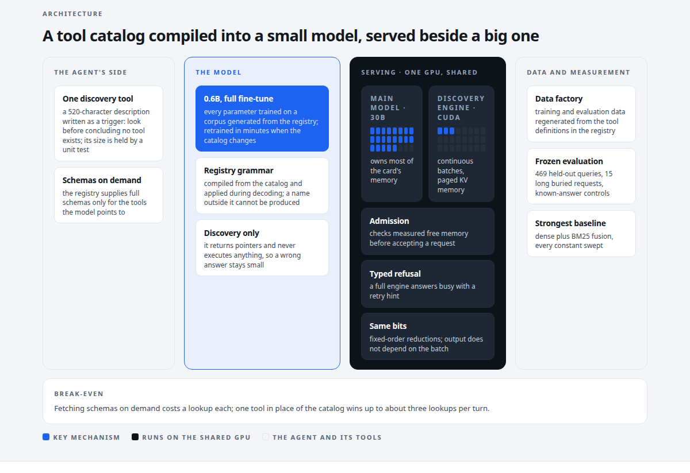
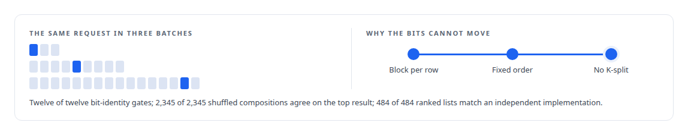

# Capabilities model

**A 0.6-billion-parameter model that memorises an agent's tool catalog, with the data, decoder, serving and evaluation around it**

Canonical: https://coreyjames.ai/systems/capabilities-model/  
Author: Corey James · Published: 2026-10-28 · Kind: system  
DOI: https://doi.org/10.5281/zenodo.23735124  
Technologies: [Admission control and rate limiting](https://github.com/coreyjames-ai/portfolio/tree/main/technologies/admission-control-and-rate-limiting) · [Binary wire protocol design](https://github.com/coreyjames-ai/portfolio/tree/main/technologies/binary-wire-protocol-design) · [CBOR](https://github.com/coreyjames-ai/portfolio/tree/main/technologies/cbor) · [CUDA C++](https://github.com/coreyjames-ai/portfolio/tree/main/technologies/cuda-c-plus-plus) · [Capacity engineering, backpressure and load testing](https://github.com/coreyjames-ai/portfolio/tree/main/technologies/capacity-engineering-backpressure-and-load-testing) · [Catalog versioning and drift detection](https://github.com/coreyjames-ai/portfolio/tree/main/technologies/catalog-versioning-and-drift-detection) · [Determinism and numerical reproducibility](https://github.com/coreyjames-ai/portfolio/tree/main/technologies/determinism-and-numerical-reproducibility) · [FAISS](https://github.com/coreyjames-ai/portfolio/tree/main/technologies/faiss) · [GPU admission control and co-residency](https://github.com/coreyjames-ai/portfolio/tree/main/technologies/gpu-admission-control-and-co-residency) · [GPU inference engine engineering](https://github.com/coreyjames-ai/portfolio/tree/main/technologies/gpu-inference-engine-engineering) · [GPU numerical kernel design](https://github.com/coreyjames-ai/portfolio/tree/main/technologies/gpu-numerical-kernel-design) · [Governed AI-assisted software engineering](https://github.com/coreyjames-ai/portfolio/tree/main/technologies/governed-ai-assisted-software-engineering) · [Grafana](https://github.com/coreyjames-ai/portfolio/tree/main/technologies/grafana) · [Grammar-constrained decoding](https://github.com/coreyjames-ai/portfolio/tree/main/technologies/grammar-constrained-decoding) · [Hugging Face Transformers](https://github.com/coreyjames-ai/portfolio/tree/main/technologies/hugging-face-transformers) · [Hybrid retrieval](https://github.com/coreyjames-ai/portfolio/tree/main/technologies/hybrid-retrieval) · [Intel Arc GPUs](https://github.com/coreyjames-ai/portfolio/tree/main/technologies/intel-arc-gpus) · [KV-cache engineering](https://github.com/coreyjames-ai/portfolio/tree/main/technologies/kv-cache-engineering) · [LLM fine-tuning](https://github.com/coreyjames-ai/portfolio/tree/main/technologies/llm-fine-tuning) · [Large-scale GPU data pipelines](https://github.com/coreyjames-ai/portfolio/tree/main/technologies/large-scale-gpu-data-pipelines) · [MCP tool design](https://github.com/coreyjames-ai/portfolio/tree/main/technologies/mcp-tool-design) · [ML evaluation methodology](https://github.com/coreyjames-ai/portfolio/tree/main/technologies/ml-evaluation-methodology) · [Model Context Protocol (MCP)](https://github.com/coreyjames-ai/portfolio/tree/main/technologies/model-context-protocol-mcp) · [Model families and types](https://github.com/coreyjames-ai/portfolio/tree/main/technologies/model-families-and-types) · [Model quantization](https://github.com/coreyjames-ai/portfolio/tree/main/technologies/model-quantization) · [NVIDIA Blackwell GPUs](https://github.com/coreyjames-ai/portfolio/tree/main/technologies/nvidia-blackwell-gpus) · [NVIDIA TensorRT-LLM](https://github.com/coreyjames-ai/portfolio/tree/main/technologies/nvidia-tensorrt-llm) · [ONNX Runtime](https://github.com/coreyjames-ai/portfolio/tree/main/technologies/onnx-runtime) · [Performance engineering and benchmarking](https://github.com/coreyjames-ai/portfolio/tree/main/technologies/performance-engineering-and-benchmarking) · [PostgreSQL](https://github.com/coreyjames-ai/portfolio/tree/main/technologies/postgresql) · [PyTorch](https://github.com/coreyjames-ai/portfolio/tree/main/technologies/pytorch) · [Python](https://github.com/coreyjames-ai/portfolio/tree/main/technologies/python) · [Research data forensics](https://github.com/coreyjames-ai/portfolio/tree/main/technologies/research-data-forensics) · [Rust](https://github.com/coreyjames-ai/portfolio/tree/main/technologies/rust) · [Static analysis as tests](https://github.com/coreyjames-ai/portfolio/tree/main/technologies/static-analysis-as-tests) · [Synthetic training-data generation](https://github.com/coreyjames-ai/portfolio/tree/main/technologies/synthetic-training-data-generation) · [TLS and mTLS](https://github.com/coreyjames-ai/portfolio/tree/main/technologies/tls-and-mtls) · [Text embedding models](https://github.com/coreyjames-ai/portfolio/tree/main/technologies/text-embedding-models) · [Unix domain sockets](https://github.com/coreyjames-ai/portfolio/tree/main/technologies/unix-domain-sockets) · [Vendor-integration reverse engineering](https://github.com/coreyjames-ai/portfolio/tree/main/technologies/vendor-integration-reverse-engineering) · [pgvector](https://github.com/coreyjames-ai/portfolio/tree/main/technologies/pgvector) · [vLLM](https://github.com/coreyjames-ai/portfolio/tree/main/technologies/vllm)  
Skills: [inference serving architecture](https://github.com/coreyjames-ai/portfolio/tree/main/skills/inference-serving-architecture) · [GPU inference optimisation](https://github.com/coreyjames-ai/portfolio/tree/main/skills/gpu-inference-optimisation) · [AI-assisted engineering methodology](https://github.com/coreyjames-ai/portfolio/tree/main/skills/ai-assisted-engineering-methodology) · [high-throughput batch inference](https://github.com/coreyjames-ai/portfolio/tree/main/skills/high-throughput-batch-inference)  


## Result

| Figure | What it measures |
| --- | --- |
| **0.955** | recall at 5 on 469 frozen queries; the best classical baseline scored 0.949 |
| **2,048** | simultaneous clients in one burst, none failed or rejected |
| **2.7 GiB** | for the whole discovery engine on the shared card |



## What was built

An agent connected to a serious tool estate pays for that estate on every turn: the schema of every tool it might call is loaded into context whether it uses one or not. On my estate that was 44 tools across three servers, measured on the wire. The quieter failure is worse: an agent that cannot see the right tool concludes it has none and improvises. I replaced the catalog with a single discovery tool backed by a 0.6-billion-parameter model that has the catalog memorised and cannot name a tool outside it. Around that model is a complete small-model system: a registry-driven data factory, a CUDA decoder whose output bits do not depend on the batch, a serving engine that lives beside a larger model on the same card, and a frozen evaluation whose strongest baseline tied the model.

## The idea

Treat the catalog as something a small model can memorise, and treat the decoder as the place to enforce validity. The agent sees one tool and describes what it needs. The model returns pointers to the tools that fit. The registry supplies full schemas for only those. A grammar compiled from the registry is applied during decoding so that names outside the catalog cannot be produced; the guarantee is validity, and the model can still pick the wrong real tool. The description of that one tool is written as a trigger, telling the agent to look before concluding no tool exists, and its size is capped by a unit test. See [A hundred tokens instead of forty-two thousand](https://coreyjames.ai/stories/a-hundred-tokens-instead-of-forty-two-thousand).


## What I built

A full fine-tune of a 0.6-billion-parameter open-weight base model on a corpus generated from the tool registry. Every parameter trains, a run takes minutes, and the model is rebuilt whenever the catalog changes.

A purpose-built CUDA decoding engine: batched and continuous, with paged key-value memory, admission against measured memory, canary-gated binding and typed refusals. It shares one GPU with a 30B model. See [A router beside a production model](https://coreyjames.ai/stories/a-router-beside-a-production-model).

Reductions ordered so that a request's output bits are identical across batch compositions: one block per output row, fixed-order shuffle trees, no K-split tiling, and the same row kernels for the serial and batched paths. See [Bit-identical across batch compositions](https://coreyjames.ai/stories/bit-identical-across-batch-compositions).



A frozen evaluation instrument: 469 held-out queries over 42 tools, fifteen long buried-request probes, known-answer controls that can catch the team, and a baseline built with the same care as the model. See [The baseline that tied us](https://coreyjames.ai/stories/the-baseline-that-tied-us).

A vendor-path study that tried the industrial serving stack first and closed it on measurements. See [Trying the industrial path first](https://coreyjames.ai/stories/trying-the-industrial-path-first).

In the same lane, my published 4-bit quantization of a 27-billion-parameter hybrid recurrent-attention open-weight model for Intel hardware. See [A 27B model on one 32 GB Intel card](https://coreyjames.ai/stories/a-27b-model-on-one-32gb-intel-card).

## Results

No run produced a tool name outside the catalog. The sustained-throughput target I pre-registered for mixed traffic was missed by a wide margin, for the memory reason drawn below. That result and its cause are in the serving story.


## The judgment in it

Full fine-tune, not adapters, because at 0.6B parameters the cost that justifies adapters was not there.

Discovery only. The model finds tools; the agent calls them. A wrong answer stays small.

I measured the break-even for fetching schemas on demand, about three lookups per turn, and documented it instead of hiding it.

My first headline had the model beating classical retrieval by seventeen points. The tie is what I publish.


## What it demonstrates

End-to-end ML systems architecture from data to weights to kernels to protocol, framing a problem so a small model is the right tool, and measurement integrity under pressure.

## Stories

[A hundred tokens instead of forty-two thousand](https://coreyjames.ai/stories/a-hundred-tokens-instead-of-forty-two-thousand) · [The baseline that tied us](https://coreyjames.ai/stories/the-baseline-that-tied-us) · [A router beside a production model](https://coreyjames.ai/stories/a-router-beside-a-production-model) · [Bit-identical across batch compositions](https://coreyjames.ai/stories/bit-identical-across-batch-compositions) · [Trying the industrial path first](https://coreyjames.ai/stories/trying-the-industrial-path-first) · [A 27B model on one 32 GB Intel card](https://coreyjames.ai/stories/a-27b-model-on-one-32gb-intel-card) · [Constraint made cheaper than no constraint](https://coreyjames.ai/stories/constraint-made-cheaper-than-no-constraint) · [Every request accounted for](https://coreyjames.ai/stories/every-request-accounted-for) · [The recovery that drained the card](https://coreyjames.ai/stories/the-recovery-that-drained-the-card) · [Prove the mechanism before the model](https://coreyjames.ai/stories/prove-the-mechanism-before-the-model) · [Reading a file format by correlation](https://coreyjames.ai/stories/reading-a-file-format-by-correlation)

## Technologies

PyTorch · Hugging Face Transformers · Full-parameter fine-tuning · Grammar-constrained decoding · CUDA · Rust · Model Context Protocol · Pre-registered evaluation design · Weight-only quantization · NVIDIA Blackwell GPUs · Intel Arc GPUs

> The baseline was weak. I struck it, built the strongest retriever I could assemble, and the model tied it.

## What was verified

Each line is a claim the canonical page supports, with the figure as the page states it.

- LLM fine-tuning for tool discovery: a 0.6-billion-parameter model fully fine-tuned on registry-generated data to memorise 44 tools across three servers, rebuilt in minutes when the catalog changes.
- Grammar-constrained decoding: a grammar compiled from the tool registry and applied during decoding, so the model cannot name a tool outside the catalog.
- Inference serving architecture: a batched, continuous CUDA decoding engine with paged key-value memory and typed refusals, 2.7 GiB on a card shared with a 30B model.
- Deterministic GPU computation: output bits identical across batch compositions through one block per output row, fixed-order reductions and no K-split tiling.
- ML evaluation methodology: recall at 5 of 0.955 on 469 frozen queries against 0.949 for the best classical baseline, published as a tie.
- Load testing for agent concurrency: 2,048 simultaneous clients in one burst, none failed or rejected.

## Related

- [A hundred tokens instead of forty-two thousand](https://github.com/coreyjames-ai/capabilities-model/tree/main/stories/a-hundred-tokens-instead-of-forty-two-thousand) · https://coreyjames.ai/stories/a-hundred-tokens-instead-of-forty-two-thousand/
- [The baseline that tied us](https://github.com/coreyjames-ai/capabilities-model/tree/main/stories/the-baseline-that-tied-us) · https://coreyjames.ai/stories/the-baseline-that-tied-us/
- [A router beside a production model](https://github.com/coreyjames-ai/capabilities-model/tree/main/stories/a-router-beside-a-production-model) · https://coreyjames.ai/stories/a-router-beside-a-production-model/
- [Bit-identical across batch compositions](https://github.com/coreyjames-ai/capabilities-model/tree/main/stories/bit-identical-across-batch-compositions) · https://coreyjames.ai/stories/bit-identical-across-batch-compositions/
- [Trying the industrial path first](https://github.com/coreyjames-ai/capabilities-model/tree/main/stories/trying-the-industrial-path-first) · https://coreyjames.ai/stories/trying-the-industrial-path-first/
- [A 27B model on one 32 GB Intel card](https://github.com/coreyjames-ai/capabilities-model/tree/main/stories/a-27b-model-on-one-32gb-intel-card) · https://coreyjames.ai/stories/a-27b-model-on-one-32gb-intel-card/
- [Constraint made cheaper than no constraint](https://github.com/coreyjames-ai/capabilities-model/tree/main/stories/constraint-made-cheaper-than-no-constraint) · https://coreyjames.ai/stories/constraint-made-cheaper-than-no-constraint/
- [Every request accounted for](https://github.com/coreyjames-ai/capabilities-model/tree/main/stories/every-request-accounted-for) · https://coreyjames.ai/stories/every-request-accounted-for/
- [The recovery that drained the card](https://github.com/coreyjames-ai/capabilities-model/tree/main/stories/the-recovery-that-drained-the-card) · https://coreyjames.ai/stories/the-recovery-that-drained-the-card/
- [Prove the mechanism before the model](https://github.com/coreyjames-ai/capabilities-model/tree/main/stories/prove-the-mechanism-before-the-model) · https://coreyjames.ai/stories/prove-the-mechanism-before-the-model/
- [Reading a file format by correlation](https://github.com/coreyjames-ai/capabilities-model/tree/main/stories/reading-a-file-format-by-correlation) · https://coreyjames.ai/stories/reading-a-file-format-by-correlation/

## Skills demonstrated

Decided at build time against every page in this system, strongest first; each links to the page that earns it.

- [TensorRT and TensorRT-LLM engineering](https://github.com/coreyjames-ai/portfolio/tree/main/skills/tensorrt-and-tensorrt-llm-engineering) · [Trying the industrial path first](https://github.com/coreyjames-ai/capabilities-model/tree/main/stories/trying-the-industrial-path-first)
- [inference serving architecture](https://github.com/coreyjames-ai/portfolio/tree/main/skills/inference-serving-architecture) · [Capabilities model](https://github.com/coreyjames-ai/capabilities-model)
- [CUDA kernel development](https://github.com/coreyjames-ai/portfolio/tree/main/skills/cuda-kernel-development) · [Constraint made cheaper than no constraint](https://github.com/coreyjames-ai/capabilities-model/tree/main/stories/constraint-made-cheaper-than-no-constraint)
- [MCP server design](https://github.com/coreyjames-ai/portfolio/tree/main/skills/mcp-server-design) · [Every request accounted for](https://github.com/coreyjames-ai/capabilities-model/tree/main/stories/every-request-accounted-for)

## Engineering stories in Capabilities model (11)

| Story | Result | Figure |
| --- | --- | --- |
| [A hundred tokens instead of forty-two thousand](stories/a-hundred-tokens-instead-of-forty-two-thousand) | Compiling an agent's tool catalog into a 0.6-billion-parameter model that cannot invent a tool | 0.955 |
| [The baseline that tied us](stories/the-baseline-that-tied-us) | Retiring a flattering benchmark, building the strongest retriever I could, and publishing the result that hurt | 17 |
| [A router beside a production model](stories/a-router-beside-a-production-model) | Serving two thousand concurrent agents from a 0.6B model in the memory left over on a shared GPU, and reporting the target I missed | 2.7 GiB |
| [Bit-identical across batch compositions](stories/bit-identical-across-batch-compositions) | Designing nondeterminism out of a GPU decoder so an agent's choice of tool never depends on its neighbours | 12 of 12 |
| [Trying the industrial path first](stories/trying-the-industrial-path-first) | Evaluating the standard vendor serving stack for a custom decoder, and closing that path on measurements | 4 |
| [A 27B model on one 32 GB Intel card](stories/a-27b-model-on-one-32gb-intel-card) | A measured, attributed and published 4-bit quantization of a 27-billion-parameter hybrid recurrent-attention open-weight model for an Intel Arc Pro GPU | +36% |
| [Constraint made cheaper than no constraint](stories/constraint-made-cheaper-than-no-constraint) | A grammar-bounded CUDA decoder in which enforcing the tool catalog costs less than not enforcing it | 172 µs |
| [Every request accounted for](stories/every-request-accounted-for) | The tool-discovery model's fleet daemon has a nine-point service contract: 512 requests offered to 64 clients with a queue of sixteen gave 244 answered, 268 refused with a typed reason and none dropped, and a shutdown that answered every request in flight | 244 |
| [The recovery that drained the card](stories/the-recovery-that-drained-the-card) | Four failed engine loads took a shared GPU from 1,801 MiB free to 2, because partial allocations were never released; the fix made creation crash-safe and made the admission arithmetic match the allocation it predicts | 4 |
| [Prove the mechanism before the model](stories/prove-the-mechanism-before-the-model) | Three load-bearing ideas behind the custom decoder, a device-side graph loop, a persisting L2 window and a constant-memory trie mask, were each proved on the real GPU in a small lab before the model existed, and one of them contradicted the documentation | 4.304 µs |
| [Reading a file format by correlation](stories/reading-a-file-format-by-correlation) | The four-bit weight format's layout was established by correlating candidate decodings against the known weights before a kernel was written, 0.9955 against 0.0018, and four-bit was positioned as a footprint win rather than a speed win | 256 |

Part of [Corey James's portfolio](https://github.com/coreyjames-ai/portfolio): research, technologies, skills and the other systems. Canonical site: https://coreyjames.ai/

## Citation

Corey James. "Capabilities model." coreyjames.ai, 2026. https://coreyjames.ai/systems/capabilities-model/ In: the Capabilities model technical report, doi:10.5281/zenodo.23735124.

```bibtex
@misc{coreyjames-capabilities-model,
  author = {Corey James},
  title = {Capabilities model},
  year = {2026},
  howpublished = {\url{https://coreyjames.ai/systems/capabilities-model/}},
  note = {GitHub copy: https://github.com/coreyjames-ai/capabilities-model},
  doi = {10.5281/zenodo.23735124}
}
```

Part of [Capabilities model](https://github.com/coreyjames-ai/capabilities-model) and [Corey James's portfolio](https://github.com/coreyjames-ai/portfolio) · site: https://coreyjames.ai/ · MCP server: https://coreyjames.ai/mcp · agent card: https://coreyjames.ai/.well-known/agent.json
