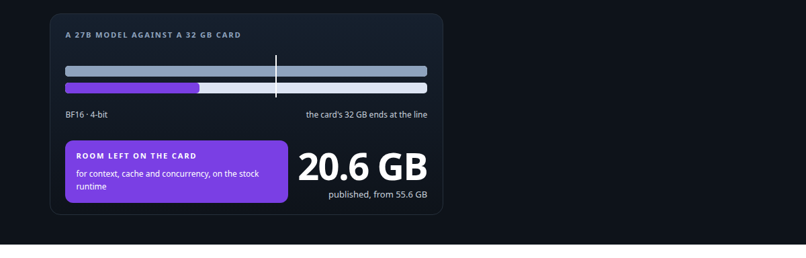
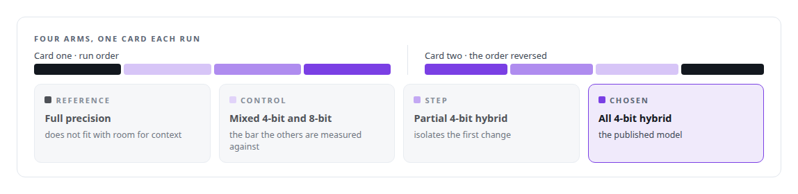
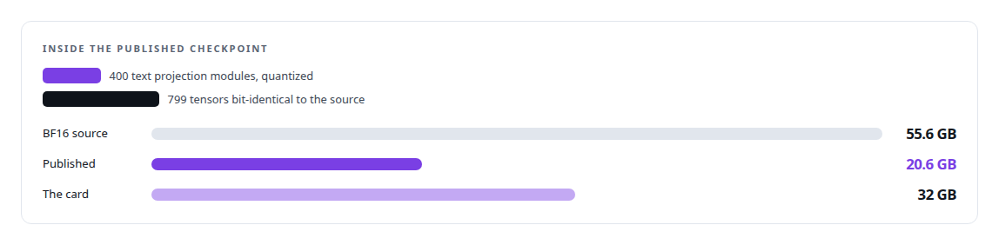
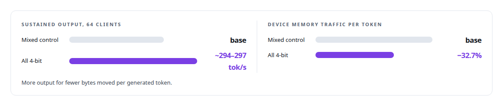

# A 27B model on one 32 GB Intel card

**A measured, attributed and published 4-bit quantization of a 27-billion-parameter hybrid recurrent-attention open-weight model for an Intel Arc Pro GPU**

Canonical: https://coreyjames.ai/stories/a-27b-model-on-one-32gb-intel-card/  
Author: Corey James · Published: 2026-10-28 · Kind: story  
Systems: [Capabilities model](https://github.com/coreyjames-ai/capabilities-model) · [ActiveKV](https://github.com/coreyjames-ai/activekv)  
Technologies: [Hugging Face Hub](https://github.com/coreyjames-ai/portfolio/tree/main/technologies/hugging-face-hub) · [Intel Arc GPUs](https://github.com/coreyjames-ai/portfolio/tree/main/technologies/intel-arc-gpus) · [ML evaluation methodology](https://github.com/coreyjames-ai/portfolio/tree/main/technologies/ml-evaluation-methodology) · [Model families and types](https://github.com/coreyjames-ai/portfolio/tree/main/technologies/model-families-and-types) · [Model quantization](https://github.com/coreyjames-ai/portfolio/tree/main/technologies/model-quantization) · [PyTorch](https://github.com/coreyjames-ai/portfolio/tree/main/technologies/pytorch) · [vLLM](https://github.com/coreyjames-ai/portfolio/tree/main/technologies/vllm)  
Skills: [GPU inference optimisation](https://github.com/coreyjames-ai/portfolio/tree/main/skills/gpu-inference-optimisation) · [LLM quantization (FP8, INT8, 4-bit)](https://github.com/coreyjames-ai/portfolio/tree/main/skills/llm-quantization-fp8-int8-4-bit) · [high-throughput batch inference](https://github.com/coreyjames-ai/portfolio/tree/main/skills/high-throughput-batch-inference) · [AI-assisted engineering methodology](https://github.com/coreyjames-ai/portfolio/tree/main/skills/ai-assisted-engineering-methodology)  



## Result

| Figure | What it measures |
| --- | --- |
| **+36%** | sustained output throughput over the mixed 4-bit and 8-bit control, 64 clients |
| **3.33%** | higher perplexity than full precision on an 8-document diagnostic set |
| **1,798** | tokens per second total at 32 clients, 1,536-token prompts, prefix caching on |

## What was built

The base model, a 27-billion-parameter hybrid recurrent-attention open-weight model, does not fit in BF16 on a 32 GB Intel Arc Pro GPU, and I needed it to, with room left for context and concurrency. I built a 4-bit-weight quantization that fits it, ran a four-arm experiment to attribute exactly where the speed came from, and published the model with its card on Hugging Face. The model card states the trade-off in plain numbers.

## The challenge

Fitting a large model on a smaller card is routine on NVIDIA hardware with mature tooling. On a new Intel architecture, with a stock XPU build of vLLM and no forked kernels, it was not. And a quantization you intend to publish has to be provable: which source weights, which revision, which tensors changed and which did not, measured on your own diagnostics.

## Constraints

Stock runtime: the model had to run on the unmodified Intel XPU vLLM build, so the format had to be one the runtime already understood. Provenance: source pinned to a revision with every shard hash checked, every quantized module listed in a manifest. Attribution: a speed gain can come from smaller weights, from different kernels, or from the memory freed for cache, and I wanted to know which.

## My approach

A four-arm experiment on the same card: the full-precision reference, a mixed 4-bit and 8-bit control, a partial 4-bit hybrid, and an all-4-bit hybrid. Each arm was measured on the same card, with the order crossed over across two cards so no arm benefited from a particular device or warm state. The gain of each arm is then attributable to what changed between it and its neighbour.



## What I built

A weight-only W4A16 recipe: 4-bit symmetric weights, group size 32, BF16 scales, rounded straight from the hash-checked original weights with no calibration data.



Per-module manifests and hash-replayed measurements, so any figure traces to the artefact it was measured on.

Release validation on the exact upload copy, 433 files checked per checkpoint.

A model card that states the method, the trade-off and the measurement conditions.

## Difficult decisions

Choosing the all-4-bit arm. It cost some perplexity, it bought throughput, and it moved fewer bytes per generated token.


Skipping calibration. Calibrated quantization can be closer to the original. Round-to-nearest from hash-checked weights is simpler, reproducible from the source alone, and leaves nothing to a calibration set that readers cannot inspect. I chose provenance.

Making no "best" claim. The card describes what this model is and what it costs, and leaves comparison to the reader.

## Results

On one Intel Arc Pro GPU, the all-4-bit model against the mixed control:



The model my ActiveKV work serves is a same-recipe build of a different checkpoint.

## Technologies used

Weight-only W4A16 quantization · compressed-tensors format · Intel XPU vLLM · PyTorch XPU · Intel Arc GPUs · Hugging Face Hub publication · Hybrid recurrent-attention 27B-class models

## What this demonstrates

Model-deployment engineering on non-NVIDIA hardware, an experimental design that separates kernel effects from capacity effects, and publication that tells the reader exactly what they are getting.

The base model is a third party's open-weight release; the runtime is Intel's.

> I took the throughput and stated the cost.

## What was verified

Each line is a claim the canonical page supports, with the figure as the page states it.

- LLM quantization (4-bit): a weight-only W4A16 recipe for a 27-billion-parameter hybrid model, rounded from hash-checked weights with no calibration data, at 3.33% higher perplexity than full precision.
- Intel GPU inference: a 27B model fitted on one 32 GB Intel Arc Pro GPU under the unmodified Intel XPU build of vLLM, 1,798 tokens per second in total at 32 clients.
- Experimental design for performance attribution: a four-arm experiment crossed over across two cards, attributing a +36% sustained throughput gain at 64 clients to what changed between arms.
- Model publication and provenance: a model published on Hugging Face with per-module manifests, hash-replayed measurements and release validation of 433 files per checkpoint.

## Related

- [Context beyond VRAM](https://github.com/coreyjames-ai/activekv/tree/main/stories/context-beyond-vram) · https://coreyjames.ai/stories/context-beyond-vram/
- [Bringing a serving stack up on new silicon](https://github.com/coreyjames-ai/activekv/tree/main/stories/bringing-a-serving-stack-up-on-new-silicon) · https://coreyjames.ai/stories/bringing-a-serving-stack-up-on-new-silicon/

## Citation

Corey James. "A 27B model on one 32 GB Intel card." coreyjames.ai, 2026. https://coreyjames.ai/stories/a-27b-model-on-one-32gb-intel-card/

```bibtex
@misc{coreyjames-a-27b-model-on-one-32gb-intel-card,
  author = {Corey James},
  title = {A 27B model on one 32 GB Intel card},
  year = {2026},
  howpublished = {\url{https://coreyjames.ai/stories/a-27b-model-on-one-32gb-intel-card/}},
  note = {GitHub copy: https://github.com/coreyjames-ai/capabilities-model/tree/main/stories/a-27b-model-on-one-32gb-intel-card}
}
```

Part of [Capabilities model](https://github.com/coreyjames-ai/capabilities-model) and [Corey James's portfolio](https://github.com/coreyjames-ai/portfolio) · site: https://coreyjames.ai/ · MCP server: https://coreyjames.ai/mcp · agent card: https://coreyjames.ai/.well-known/agent.json
