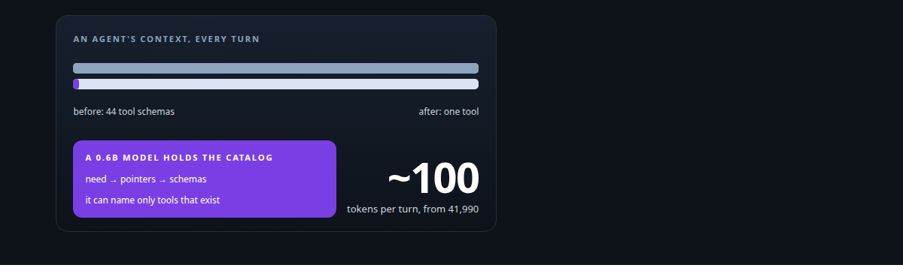
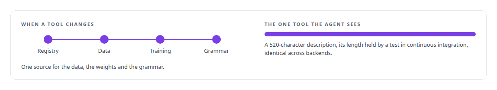
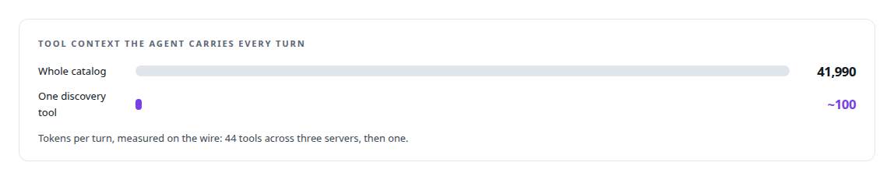

# A hundred tokens instead of forty-two thousand

**Compiling an agent's tool catalog into a 0.6-billion-parameter model that cannot invent a tool**

Canonical: https://coreyjames.ai/stories/a-hundred-tokens-instead-of-forty-two-thousand/  
Author: Corey James · Published: 2026-10-28 · Kind: story  
DOI: https://doi.org/10.5281/zenodo.23735124 (this page is a chapter of the system's report)  
Systems: [Capabilities model](https://github.com/coreyjames-ai/capabilities-model)  
Technologies: [CUDA C++](https://github.com/coreyjames-ai/portfolio/tree/main/technologies/cuda-c-plus-plus) · [Grammar-constrained decoding](https://github.com/coreyjames-ai/portfolio/tree/main/technologies/grammar-constrained-decoding) · [Hugging Face Transformers](https://github.com/coreyjames-ai/portfolio/tree/main/technologies/hugging-face-transformers) · [LLM fine-tuning](https://github.com/coreyjames-ai/portfolio/tree/main/technologies/llm-fine-tuning) · [MCP tool design](https://github.com/coreyjames-ai/portfolio/tree/main/technologies/mcp-tool-design) · [Model Context Protocol (MCP)](https://github.com/coreyjames-ai/portfolio/tree/main/technologies/model-context-protocol-mcp) · [Model families and types](https://github.com/coreyjames-ai/portfolio/tree/main/technologies/model-families-and-types) · [NVIDIA Blackwell GPUs](https://github.com/coreyjames-ai/portfolio/tree/main/technologies/nvidia-blackwell-gpus) · [PyTorch](https://github.com/coreyjames-ai/portfolio/tree/main/technologies/pytorch) · [Rust](https://github.com/coreyjames-ai/portfolio/tree/main/technologies/rust) · [Static analysis as tests](https://github.com/coreyjames-ai/portfolio/tree/main/technologies/static-analysis-as-tests) · [Synthetic training-data generation](https://github.com/coreyjames-ai/portfolio/tree/main/technologies/synthetic-training-data-generation) · [vLLM](https://github.com/coreyjames-ai/portfolio/tree/main/technologies/vllm)  
Skills: [GPU inference optimisation](https://github.com/coreyjames-ai/portfolio/tree/main/skills/gpu-inference-optimisation) · [AI-assisted engineering methodology](https://github.com/coreyjames-ai/portfolio/tree/main/skills/ai-assisted-engineering-methodology) · [inference serving architecture](https://github.com/coreyjames-ai/portfolio/tree/main/skills/inference-serving-architecture) · [cost attribution for AI work](https://github.com/coreyjames-ai/portfolio/tree/main/skills/cost-attribution-for-ai-work)  



## Result

| Figure | What it measures |
| --- | --- |
| **0.955** | recall at 5; the strongest classical baseline scored 0.949 |
| **none** | tool names outside the catalog, in any run |
| **2,048** | simultaneous clients in a burst, none failed or rejected |
| **2.7 GiB** | engine memory on the card the 30B model already uses |

## What was built

An agent connected to a serious tool estate pays for that estate on every turn. The schema of every tool it might call is loaded into context whether it uses one or not. Measured on the wire, that cost was mine on every turn. I replaced the catalog with a single discovery tool backed by a 0.6-billion-parameter model that has the catalog memorised and cannot name a tool that does not exist. The model's recall matches the strongest retrieval baseline I could build, and that tie is published beside it.

## The challenge

Two failures, both expensive. The standing tax: every tool an agent can reach is described to it on every request, so a rich estate makes every turn slower and costlier before any work is done. And the quiet failure: an agent that cannot see the right tool concludes it has no tool for the job and improvises. Both get worse as the estate grows, and I was growing the estate on purpose.

## Constraints

One GPU, already busy: the discovery model had to live beside a roughly 30-billion-parameter main model on the same card. Never invent a tool: a wrong real tool name is a recoverable error, a plausible fake one is a silent failure. Rebuildable in minutes, because tools change weekly. And honest numbers, because a small model's recall only means something against a strong baseline.

## My approach

I treated the catalog as something a small model can memorise and the decoder as the place to enforce validity.

The agent sees one tool. It describes what it needs; the model returns pointers to the tools that fit; the registry supplies the full schema for only those. The description of that one tool is written as a trigger: it tells the agent when to call it and, in particular, to call it before ever concluding that no tool exists. Its size is capped by a unit test, so nobody can quietly grow it back toward the old catalog.


## What I built

A full fine-tune of a 0.6-billion-parameter open-weight base model on a corpus generated from the tool registry. Every parameter trains, the run takes minutes, and the model is rebuilt whenever the registry changes.



A grammar compiled from the registry and applied during decoding, so that names outside the catalog cannot be produced. The guarantee is validity. The model can still pick the wrong real tool and never a fictional one.

A purpose-built CUDA decoding engine for the model, so that hosting it costs the shared GPU almost nothing.

A registry-driven data factory that regenerates training and evaluation data from the tool definitions.

A frozen evaluation instrument: 469 held-out queries over the catalog, fixed before any result was reported, with known-answer controls that can catch the team as readily as the model.

## Difficult decisions

Full fine-tune, not adapters. At 0.6B parameters a full fine-tune finishes in minutes and removes a layer of indirection, and the cost that usually justifies adapters was not there.

Discovery only. The model finds tools and does not call them. Keeping execution with the agent kept the blast radius of a wrong answer small.

Paying per lookup. Collapsing the catalog to one tool means full schemas are fetched on demand. The break-even is around three lookups per turn, and that boundary is documented.

Publishing the tie. My first headline had the model beating classical retrieval by seventeen points of recall. I built the strongest retriever I could assemble, and the model tied it at k=5 and k=10 and lost on long, buried requests. That is the number on this page.


## Results

Measured on the three-server estate, on one GPU shared with the 30B model, with 469 frozen queries over 42 tools.



The sustained-throughput target I pre-registered for mixed traffic was missed for a structural reason to do with memory left for long requests. That result and its cause are in [A router beside a production model](https://coreyjames.ai/stories/a-router-beside-a-production-model).

## Technologies used

Rust · CUDA · PyTorch · Hugging Face Transformers · Full-parameter fine-tuning · Grammar-constrained decoding · Model Context Protocol · vLLM · Small router models · NVIDIA Blackwell GPUs · Pre-registered evaluation design

## What this demonstrates

I can take a problem everyone treats as a prompt-engineering nuisance, reframe it as a small-model systems problem, and carry it end to end: data generation, training, a custom decoder, the serving engine, the protocol surface and the evaluation. When the honest baseline erased my headline, the honest baseline is what I published.

> The baseline was weak. I struck the comparison.

## What was verified

Each line is a claim the canonical page supports, with the figure as the page states it.

- LLM fine-tuning for tool discovery: a 0.6-billion-parameter model fully fine-tuned on a corpus generated from the tool registry, rebuilt in minutes whenever the registry changes.
- Grammar-constrained decoding: a grammar compiled from the registry and applied during decoding, so no tool name outside the catalog was produced in any run.
- Context-window cost reduction for agents: an agent's whole tool catalog replaced by one discovery tool, about a hundred tokens of standing context in place of forty-two thousand.
- ML evaluation methodology: recall at 5 of 0.955 against 0.949 for the strongest classical baseline I could build, with the tie published beside the model.
- GPU inference on shared hardware: a CUDA decoding engine in 2.7 GiB on the card a 30B model already uses, serving a burst of 2,048 simultaneous clients with none failed.

## Related

- [The baseline that tied us](https://github.com/coreyjames-ai/capabilities-model/tree/main/stories/the-baseline-that-tied-us) · https://coreyjames.ai/stories/the-baseline-that-tied-us/
- [A router beside a production model](https://github.com/coreyjames-ai/capabilities-model/tree/main/stories/a-router-beside-a-production-model) · https://coreyjames.ai/stories/a-router-beside-a-production-model/
- [A 27B model on one 32 GB Intel card](https://github.com/coreyjames-ai/capabilities-model/tree/main/stories/a-27b-model-on-one-32gb-intel-card) · https://coreyjames.ai/stories/a-27b-model-on-one-32gb-intel-card/

## Citation

Corey James. "A hundred tokens instead of forty-two thousand." coreyjames.ai, 2026. https://coreyjames.ai/stories/a-hundred-tokens-instead-of-forty-two-thousand/ In: the Capabilities model technical report, doi:10.5281/zenodo.23735124.

```bibtex
@misc{coreyjames-a-hundred-tokens-instead-of-forty-two-thousand,
  author = {Corey James},
  title = {A hundred tokens instead of forty-two thousand},
  year = {2026},
  howpublished = {\url{https://coreyjames.ai/stories/a-hundred-tokens-instead-of-forty-two-thousand/}},
  note = {GitHub copy: https://github.com/coreyjames-ai/capabilities-model/tree/main/stories/a-hundred-tokens-instead-of-forty-two-thousand},
  doi = {10.5281/zenodo.23735124}
}
```

Part of [Capabilities model](https://github.com/coreyjames-ai/capabilities-model) and [Corey James's portfolio](https://github.com/coreyjames-ai/portfolio) · site: https://coreyjames.ai/ · MCP server: https://coreyjames.ai/mcp · agent card: https://coreyjames.ai/.well-known/agent.json
