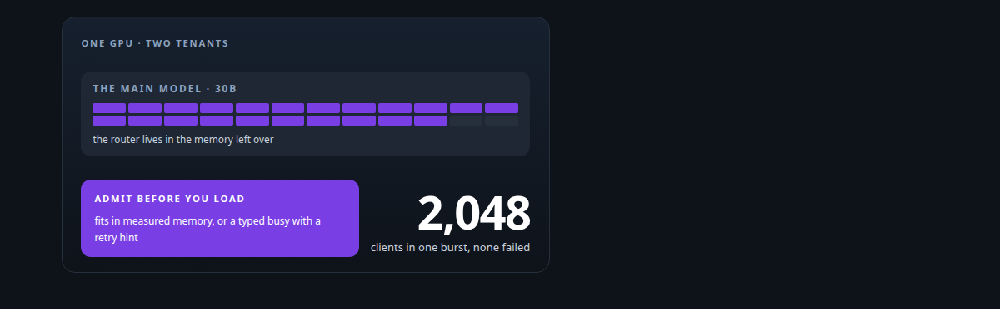
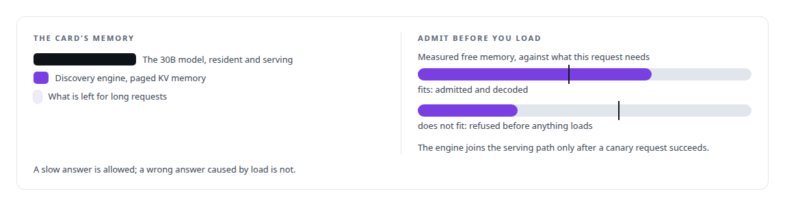
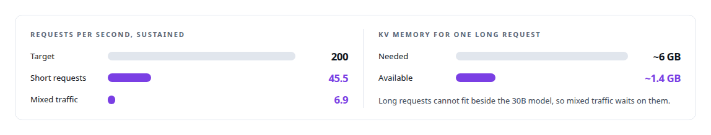

# A router beside a production model

**Serving two thousand concurrent agents from a 0.6B model in the memory left over on a shared GPU, and reporting the target I missed**

Canonical: https://coreyjames.ai/stories/a-router-beside-a-production-model/  
Author: Corey James · Published: 2026-10-28 · Kind: story  
Systems: [Capabilities model](https://github.com/coreyjames-ai/capabilities-model)  
Technologies: [Admission control and rate limiting](https://github.com/coreyjames-ai/portfolio/tree/main/technologies/admission-control-and-rate-limiting) · [Binary wire protocol design](https://github.com/coreyjames-ai/portfolio/tree/main/technologies/binary-wire-protocol-design) · [CUDA C++](https://github.com/coreyjames-ai/portfolio/tree/main/technologies/cuda-c-plus-plus) · [Capacity engineering, backpressure and load testing](https://github.com/coreyjames-ai/portfolio/tree/main/technologies/capacity-engineering-backpressure-and-load-testing) · [GPU admission control and co-residency](https://github.com/coreyjames-ai/portfolio/tree/main/technologies/gpu-admission-control-and-co-residency) · [GPU inference engine engineering](https://github.com/coreyjames-ai/portfolio/tree/main/technologies/gpu-inference-engine-engineering) · [KV-cache engineering](https://github.com/coreyjames-ai/portfolio/tree/main/technologies/kv-cache-engineering) · [ML evaluation methodology](https://github.com/coreyjames-ai/portfolio/tree/main/technologies/ml-evaluation-methodology) · [Model Context Protocol (MCP)](https://github.com/coreyjames-ai/portfolio/tree/main/technologies/model-context-protocol-mcp) · [Model families and types](https://github.com/coreyjames-ai/portfolio/tree/main/technologies/model-families-and-types) · [NVIDIA Blackwell GPUs](https://github.com/coreyjames-ai/portfolio/tree/main/technologies/nvidia-blackwell-gpus) · [Performance engineering and benchmarking](https://github.com/coreyjames-ai/portfolio/tree/main/technologies/performance-engineering-and-benchmarking) · [Rust](https://github.com/coreyjames-ai/portfolio/tree/main/technologies/rust) · [Unix domain sockets](https://github.com/coreyjames-ai/portfolio/tree/main/technologies/unix-domain-sockets)  
Skills: [inference serving architecture](https://github.com/coreyjames-ai/portfolio/tree/main/skills/inference-serving-architecture) · [high-throughput batch inference](https://github.com/coreyjames-ai/portfolio/tree/main/skills/high-throughput-batch-inference) · [vLLM internals](https://github.com/coreyjames-ai/portfolio/tree/main/skills/vllm-internals) · [AI-assisted engineering methodology](https://github.com/coreyjames-ai/portfolio/tree/main/skills/ai-assisted-engineering-methodology)  



## Result

| Figure | What it measures |
| --- | --- |
| **2.7 GiB** | the engine's whole footprint beside a 30B model |
| **85.9/s** | requests served during the largest burst |
| **0** | answers failed, rejected or contaminated in that burst |

## What was built

The tool-discovery model had to live on a GPU whose memory belonged to a 30-billion-parameter serving model. I set two thousand concurrent clients as an acceptance requirement, and built an engine that admits work against measured memory and refuses with a number when it cannot. The sustained throughput target I had pre-registered for mixed traffic was missed by a wide margin, for a reason I can name, and that miss is on this page.

## The challenge

A discovery model that agents call before most actions will be called by many agents at once. If it falls over under load, every agent stalls at the same moment. It had to serve a burst of thousands, never return a corrupted answer under pressure, and do that inside whatever memory the 30B model left behind.

## Constraints

A hard memory budget on a shared Blackwell GPU, with the 30B model resident and serving. Correctness under overload came before throughput. A pre-registered target for sustained mixed traffic, written down before the engine existed.

## My approach

Admit before you load. The engine measures the memory it has, decides whether a request fits before accepting it, and reports busy as a typed refusal with a number attached. Concurrency of two thousand was an acceptance criterion from the start, tested by a load ladder from one client to 2,048 with abort conditions at each rung.



## What I built

A batched, continuous-decode engine with paged key-value memory, so many clients share the GPU without each reserving a full context.

A load ladder from one to 2,048 clients with abort conditions, so a failure stops the test instead of being averaged into it.

## Difficult decisions

Reporting the miss. On mixed traffic the engine fell far short of the target, and a friendlier accounting method would have shown about 14 requests per second. I reported the plain number with its cause, drawn below.


## Results

On one GPU with the 30B model resident:



## Technologies used

CUDA · Rust · Unix-socket wire protocol · Model Context Protocol over TLS · Memory-aware admission control · NVIDIA Blackwell GPUs

## What this demonstrates

Systems engineering under a hard resource limit, with correctness protected ahead of throughput, and capacity reporting that tells the reader what the system cannot do as plainly as what it can.

> The miss is structural, and saying so is more useful to the next design than a better-looking number.

## What was verified

Each line is a claim the canonical page supports, with the figure as the page states it.

- Inference serving architecture: a batched continuous-decode engine with paged key-value memory, 2.7 GiB in total beside a 30B model on one shared GPU.
- Admission control under memory pressure: requests admitted against measured free memory and refused as a typed busy response with a number when they do not fit.
- Load testing methodology: a ladder from one to 2,048 clients with abort conditions, 85.9 requests a second in the largest burst and 0 answers failed, rejected or contaminated.
- Capacity reporting: a pre-registered sustained throughput target for mixed traffic reported as missed, with its cause, instead of a friendlier accounting of about 14 requests a second.

## Related

- [A hundred tokens instead of forty-two thousand](https://github.com/coreyjames-ai/capabilities-model/tree/main/stories/a-hundred-tokens-instead-of-forty-two-thousand) · https://coreyjames.ai/stories/a-hundred-tokens-instead-of-forty-two-thousand/
- [Bit-identical across batch compositions](https://github.com/coreyjames-ai/capabilities-model/tree/main/stories/bit-identical-across-batch-compositions) · https://coreyjames.ai/stories/bit-identical-across-batch-compositions/
- [Trying the industrial path first](https://github.com/coreyjames-ai/capabilities-model/tree/main/stories/trying-the-industrial-path-first) · https://coreyjames.ai/stories/trying-the-industrial-path-first/

## Citation

Corey James. "A router beside a production model." coreyjames.ai, 2026. https://coreyjames.ai/stories/a-router-beside-a-production-model/

```bibtex
@misc{coreyjames-a-router-beside-a-production-model,
  author = {Corey James},
  title = {A router beside a production model},
  year = {2026},
  howpublished = {\url{https://coreyjames.ai/stories/a-router-beside-a-production-model/}},
  note = {GitHub copy: https://github.com/coreyjames-ai/capabilities-model/tree/main/stories/a-router-beside-a-production-model}
}
```

Part of [Capabilities model](https://github.com/coreyjames-ai/capabilities-model) and [Corey James's portfolio](https://github.com/coreyjames-ai/portfolio) · site: https://coreyjames.ai/ · MCP server: https://coreyjames.ai/mcp · agent card: https://coreyjames.ai/.well-known/agent.json
