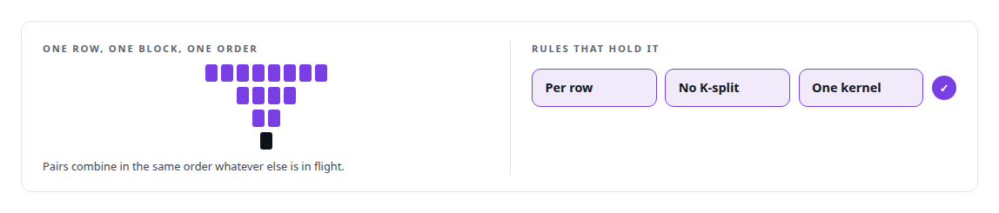

# Bit-identical across batch compositions

**Designing nondeterminism out of a GPU decoder so an agent's choice of tool never depends on its neighbours**

Canonical: https://coreyjames.ai/stories/bit-identical-across-batch-compositions/  
Author: Corey James · Published: 2026-10-28 · Kind: story  
DOI: https://doi.org/10.5281/zenodo.23735124 (this page is a chapter of the system's report)  
Systems: [Capabilities model](https://github.com/coreyjames-ai/capabilities-model)  
Technologies: [CUDA C++](https://github.com/coreyjames-ai/portfolio/tree/main/technologies/cuda-c-plus-plus) · [Determinism and numerical reproducibility](https://github.com/coreyjames-ai/portfolio/tree/main/technologies/determinism-and-numerical-reproducibility) · [GPU inference engine engineering](https://github.com/coreyjames-ai/portfolio/tree/main/technologies/gpu-inference-engine-engineering) · [GPU numerical kernel design](https://github.com/coreyjames-ai/portfolio/tree/main/technologies/gpu-numerical-kernel-design) · [Model families and types](https://github.com/coreyjames-ai/portfolio/tree/main/technologies/model-families-and-types) · [Rust](https://github.com/coreyjames-ai/portfolio/tree/main/technologies/rust)  
Skills: [CUDA kernel development](https://github.com/coreyjames-ai/portfolio/tree/main/skills/cuda-kernel-development) · [GPU inference optimisation](https://github.com/coreyjames-ai/portfolio/tree/main/skills/gpu-inference-optimisation) · [inference serving architecture](https://github.com/coreyjames-ai/portfolio/tree/main/skills/inference-serving-architecture) · [AI-assisted engineering methodology](https://github.com/coreyjames-ai/portfolio/tree/main/skills/ai-assisted-engineering-methodology)  


## Result

| Figure | What it measures |
| --- | --- |
| **12 of 12** | bit-identity gates across batch compositions |
| **2,345** | of 2,345 shuffled compositions agree on the top result |
| **484** | of 484 ranked lists match an independent implementation |

## What was built

Under continuous batching, the same request can return a different answer depending on what else is in the batch. For most workloads that is noise. For a model whose job is to tell an agent which tool to call, it is a correctness bug: the ranking must not depend on strangers. I set a gate that top results must be stable across batch compositions, then went further and built the decoder so that its output bits are identical whatever else is in the batch.

## The challenge

GPU reductions are fast because they are parallel, and parallel floating-point sums are order-dependent. Different batch sizes choose different tiling, different tiling changes summation order, and the last bits of a logit shift. Here, two candidate tools separated by a hair could swap places depending on the batch, and an agent would call a different tool for the same question. The easy fixes, double precision everywhere or batch size one, throw away the throughput that justified a dedicated decoder.


## Constraints

Determinism from structure, with no slower arithmetic and no serialised execution. The same kernels for both paths, because a serial path and a batched path that differ in code will eventually differ in bits. Throughput preserved, because the decoder exists to serve two thousand clients beside a 30B model.

## My approach

I ruled that top-result stability was the behaviour that mattered and gated on it. Then I asked for the stronger property, because the stronger property makes the weaker one provable: every output row is computed by exactly one block, reductions happen in a fixed order that does not depend on batch size, and the serial and batched engines share the same row kernels so there is only one implementation to be right.

## What I built

One block per output row, so a row's computation never spans a partition that could change with batch size.

Fixed-order reductions: a fixed 32-lane shuffle tree within a warp and a fixed 256-thread tree above it, regardless of how many rows are in flight.

No K-split tiling, which would introduce batch-dependent partial sums, taken as a limit on kernel tuning.

Shared row kernels between the serial and batched engines, enforced by a header invariant so the two cannot drift apart.



Gates that check bit-identity across batch compositions, and a cross-check of every ranked list against an independent implementation.

## Difficult decisions

Giving up tuning headroom. Forbidding K-split tiling and fixing reduction order leaves performance on the table. I took the deterministic design and recovered throughput elsewhere.


## Results

Every gate held. The cross-check of ranked lists covered all classes, both engines and two transports.

## Technologies used

CUDA · Rust · Floating-point reduction design · GPU kernel architecture

## What this demonstrates

Numerics judgment. I know where GPU nondeterminism comes from, I decide which property the application needs, and I design the arithmetic so the property holds by design and is checked by the gates.

> A faster decoder that sometimes picks a different tool is slower at the job.

## What was verified

Each line is a claim the canonical page supports, with the figure as the page states it.

- Deterministic GPU computation: a CUDA decoder whose output bits are identical whatever else is in the batch, passing 12 of 12 bit-identity gates.
- CUDA kernel development: one block per output row and fixed-order reductions, a 32-lane shuffle tree under a 256-thread tree, with no K-split tiling.
- Numerical reproducibility and bitwise validation: 2,345 of 2,345 shuffled compositions agree on the top result, and 484 of 484 ranked lists match an independent implementation.
- Inference correctness under continuous batching: serial and batched engines share one set of row kernels, held by a header invariant so the two cannot drift apart.

## Related

- [A hundred tokens instead of forty-two thousand](https://github.com/coreyjames-ai/capabilities-model/tree/main/stories/a-hundred-tokens-instead-of-forty-two-thousand) · https://coreyjames.ai/stories/a-hundred-tokens-instead-of-forty-two-thousand/
- [A router beside a production model](https://github.com/coreyjames-ai/capabilities-model/tree/main/stories/a-router-beside-a-production-model) · https://coreyjames.ai/stories/a-router-beside-a-production-model/

## Citation

Corey James. "Bit-identical across batch compositions." coreyjames.ai, 2026. https://coreyjames.ai/stories/bit-identical-across-batch-compositions/ In: the Capabilities model technical report, doi:10.5281/zenodo.23735124.

```bibtex
@misc{coreyjames-bit-identical-across-batch-compositions,
  author = {Corey James},
  title = {Bit-identical across batch compositions},
  year = {2026},
  howpublished = {\url{https://coreyjames.ai/stories/bit-identical-across-batch-compositions/}},
  note = {GitHub copy: https://github.com/coreyjames-ai/capabilities-model/tree/main/stories/bit-identical-across-batch-compositions},
  doi = {10.5281/zenodo.23735124}
}
```

Part of [Capabilities model](https://github.com/coreyjames-ai/capabilities-model) and [Corey James's portfolio](https://github.com/coreyjames-ai/portfolio) · site: https://coreyjames.ai/ · MCP server: https://coreyjames.ai/mcp · agent card: https://coreyjames.ai/.well-known/agent.json
