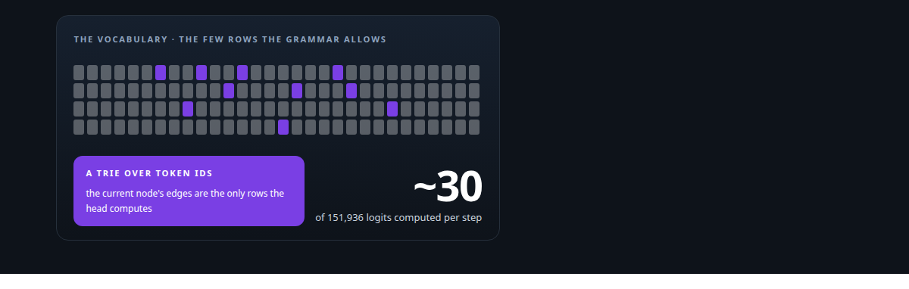
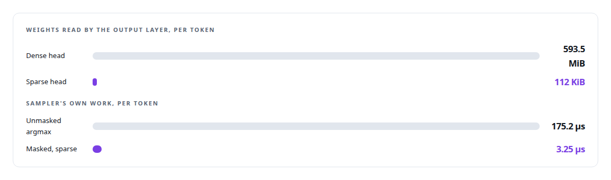
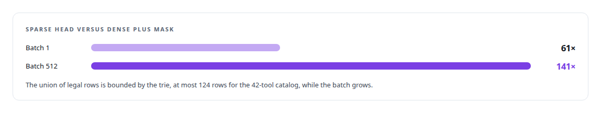
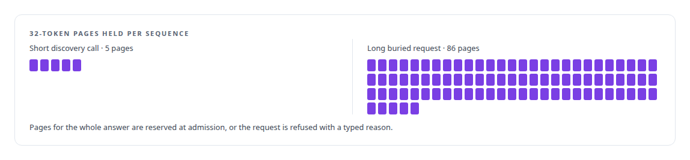

# Constraint made cheaper than no constraint

**A grammar-bounded CUDA decoder in which enforcing the tool catalog costs less than not enforcing it**

Canonical: https://coreyjames.ai/stories/constraint-made-cheaper-than-no-constraint/  
Author: Corey James · Published: 2026-10-28 · Kind: story  
Systems: [Capabilities model](https://github.com/coreyjames-ai/capabilities-model)  
Technologies: [CUDA C++](https://github.com/coreyjames-ai/portfolio/tree/main/technologies/cuda-c-plus-plus) · [Determinism and numerical reproducibility](https://github.com/coreyjames-ai/portfolio/tree/main/technologies/determinism-and-numerical-reproducibility) · [GPU inference engine engineering](https://github.com/coreyjames-ai/portfolio/tree/main/technologies/gpu-inference-engine-engineering) · [Grammar-constrained decoding](https://github.com/coreyjames-ai/portfolio/tree/main/technologies/grammar-constrained-decoding) · [NVIDIA Blackwell GPUs](https://github.com/coreyjames-ai/portfolio/tree/main/technologies/nvidia-blackwell-gpus) · [Rust](https://github.com/coreyjames-ai/portfolio/tree/main/technologies/rust)  
Skills: [GPU inference optimisation](https://github.com/coreyjames-ai/portfolio/tree/main/skills/gpu-inference-optimisation) · [CUDA kernel development](https://github.com/coreyjames-ai/portfolio/tree/main/skills/cuda-kernel-development) · [AI-assisted engineering methodology](https://github.com/coreyjames-ai/portfolio/tree/main/skills/ai-assisted-engineering-methodology) · [cost attribution for AI work](https://github.com/coreyjames-ai/portfolio/tree/main/skills/cost-attribution-for-ai-work)  



## Result

| Figure | What it measures |
| --- | --- |
| **172 µs** | less per token with the catalog enforced than with no constraint at all |
| **607** | trie nodes for 42 tools, held in 64 KiB of constant memory |
| **12 of 12** | bit-identity gates; identical top results across 2,345 shuffled batches |

## What was built

Constrained decoding is usually a tax. A serving framework computes every logit, then masks the ones the grammar forbids, then samples. My tool-discovery decoder turns that around. The grammar knows, before a token's forward pass finishes, that the answer is one of the current node's outgoing edges, so the output layer only computes those. Around that idea is a decoder I built from the ground up in CUDA: a trie in constant memory, a device-resident decode loop, a batched engine with paged memory, and determinism by construction.

## The grammar as a trie over tokens

The tool registry is compiled into a trie over the model's own token ids, stored as compressed sparse rows: an edge range per node, a token per edge, a child per edge, and two sentinel children for the control edges, one meaning "separator, another pointer follows" and one meaning "stop". Each pointer keeps the edges on its path. The product trie fits in the GPU's constant memory, which is broadcast-read and ideal for a walk where every thread wants the same node's edge list. A larger benchmark trie lives in global memory and the engine picks the path automatically.

Constant memory taught me one lesson the hard way. A one-pointer canary grammar once overwrote the product trie, and the next decode walked a trie that no longer existed. The host-side replay caught it as a token that could not be walked. Constant residency is now owned by one grammar and re-bound on every switch, and a captured device graph re-binds at launch, because graph replay replays kernels and not the host upload that filled the symbol.

## Masked sampling inside the sampler

Each step, one block of 256 threads reads the current node's edge range, filters the edges, takes the argmax over the surviving tokens, reduces across the block with a fixed tree and a deterministic tie-break on the lower token id, and advances the trie. Ties are real; the smallest measured margin between the top two candidates was zero. If the mask leaves nothing, or the winner sits on no live edge, the decoder sets an error and stops. A broken grammar fails loudly instead of producing a plausible answer.

Exactly k pointers come out because the language admits nothing else: the separator is allowed only while another pointer is still owed, the stop edge only when it is not, and the two are mutually exclusive. No pointer repeats because every edge carries a count of the live pointers below it; when a pointer completes, its path is walked and each edge decremented on the device, and an edge at zero is simply absent from the mask. That replaced a server-side approach that recompiled a shallower grammar and re-asked, at a cost of 5.58 extra round trips per query and about seven and a half times the latency on short intents. A subtler case, where one pointer's tokens are a prefix of another's, is handled by a per-pointer spent flag that masks the control edges out of a finished terminal while leaving its subtree walkable. No such pair exists in either catalog, and the invariant holds anyway.

## The sparse output layer

The dense head multiplies a 622 MB tied embedding matrix by the hidden state to produce a logit for every token in the vocabulary, and the grammar will keep a handful of them. A quarter of per-token weight traffic was spent on rows that were thrown away. The sparse head materialises the legal token set for the current node at the start of the step, with the build refusing any node with more than 256 edges so a fixed-shape buffer always suffices, then computes one dot product per candidate, one block each over a fixed grid so the shape stays data-independent and graph capture is possible, and takes the argmax with the same tie-break and transitions as the dense path.



A post-logit serving framework cannot do this, because it receives the mask after the logits exist. The dense head stays in the code and is cross-checked against the sparse one. In batched form the union of legal rows is bounded by the trie, and the sparse head's advantage over dense-plus-mask grows with the batch.



The benchmark had to be fixed before any of those numbers meant anything. Review found it never reset decode state between variants, so the masked rows had timed an early-returning no-op, and that variants attended over a cache hundreds of positions deeper than the baseline. Both were fixed and everything re-measured, with a do-nothing kernel launched in the sampler's place to separate the cost of adding a kernel from the cost of the sampler.

## The whole loop on the device

The decode loop is one captured graph: a seed step samples the first token from the prefill's logits and publishes a loop predicate, and a conditional body runs the 28-layer forward pass and the step kernel until the predicate clears. Nothing inside the body touches the host. Token, position, trie node, emitted buffer and no-repeat state all live in device memory, and every kernel that needs the current token exists in a host-argument form and a device-pointer form sharing one body, so the graph-versus-host comparison measures one decoder driven two ways. A forward pass is 451 launches. The device loop removes about 518 microseconds per token on a quiet card and more under contention, because the host loop synchronises once per token and absorbs every interruption. Output was identical host versus graph on twenty intents over 1,768 tokens. Batched prefill took the prefill of a ten-pointer query from 291 milliseconds to 21.7 with identical output.

## The batched engine

Three structures in the serial engine did not survive batching. Flat per-sequence cache allocation became a paged pool with a block table per sequence, where the flat scheme would have fit four sequences in the memory envelope.



Steps became ragged rows, each carrying its token, sequence slot and absolute position, so a decode step and a prefill chunk mix in one launch and a long prompt never blocks decodes. The no-repeat count became a 16-byte per-sequence state and a read-only per-edge bitmask: an edge is legal for a sequence when the mask of pointers below it, minus the sequence's banned set, is non-empty, which is constant-time and shared by nobody. A sequence never runs out of cache mid-answer.

Determinism is structural. One block owns one output row, reductions are fixed trees, attention accumulates in ascending position order inside one thread, and the batched engine reuses the serial engine's row kernels verbatim. Every later speed change had to be bit-identical to its reference: register-tiled matrix multiplies that stopped re-reading the activation, hardware FP8 dequantisation in place of a divergent table lookup, staged attention tiles, row-tiled prefill attention that divided cache traffic by eight, and launch fusion that took a step from 479 launches to 339. 

## What failed, kept

Staged-memory attention alone made the long-request class worse; it bought coalescing and lost occupancy. The first row-tiled attention doubled a microbenchmark and made the full evaluation six times slower, because it launched once per contiguous run and tiled on run length without requiring depth. Graph replay for the batched step was priced at under 1.26 times and declined in favour of launch fusion.


## What this demonstrates

I can see where an inference framework's abstraction boundary costs money and build below it. The decoder is numerically exact, catalog-safe by construction, and faster constrained than unconstrained, and every claim about it was re-measured after the benchmark itself was found wanting.

> Nothing is kept until it moves the 469-query wall clock.

## What was verified

Each line is a claim the canonical page supports, with the figure as the page states it.

- Grammar-constrained decoding: a CUDA decoder whose output layer computes only the edges the trie permits, 172 µs less per token with the catalog enforced than with no constraint.
- CUDA kernel development: a token trie of 607 nodes for 42 tools held in 64 KiB of constant memory, with masked sampling in one block of 256 threads.
- Deterministic GPU computation: 12 of 12 bit-identity gates and identical top results across 2,345 shuffled batches.
- Fail-loud inference design: a decoder that stops with an error when the mask leaves nothing, so a broken grammar never produces a plausible answer.

## Related

- [A hundred tokens instead of forty-two thousand](https://github.com/coreyjames-ai/capabilities-model/tree/main/stories/a-hundred-tokens-instead-of-forty-two-thousand) · https://coreyjames.ai/stories/a-hundred-tokens-instead-of-forty-two-thousand/
- [Bit-identical across batch compositions](https://github.com/coreyjames-ai/capabilities-model/tree/main/stories/bit-identical-across-batch-compositions) · https://coreyjames.ai/stories/bit-identical-across-batch-compositions/
- [A router beside a production model](https://github.com/coreyjames-ai/capabilities-model/tree/main/stories/a-router-beside-a-production-model) · https://coreyjames.ai/stories/a-router-beside-a-production-model/
- [Trying the industrial path first](https://github.com/coreyjames-ai/capabilities-model/tree/main/stories/trying-the-industrial-path-first) · https://coreyjames.ai/stories/trying-the-industrial-path-first/

## Citation

Corey James. "Constraint made cheaper than no constraint." coreyjames.ai, 2026. https://coreyjames.ai/stories/constraint-made-cheaper-than-no-constraint/

```bibtex
@misc{coreyjames-constraint-made-cheaper-than-no-constraint,
  author = {Corey James},
  title = {Constraint made cheaper than no constraint},
  year = {2026},
  howpublished = {\url{https://coreyjames.ai/stories/constraint-made-cheaper-than-no-constraint/}},
  note = {GitHub copy: https://github.com/coreyjames-ai/capabilities-model/tree/main/stories/constraint-made-cheaper-than-no-constraint}
}
```

Part of [Capabilities model](https://github.com/coreyjames-ai/capabilities-model) and [Corey James's portfolio](https://github.com/coreyjames-ai/portfolio) · site: https://coreyjames.ai/ · MCP server: https://coreyjames.ai/mcp · agent card: https://coreyjames.ai/.well-known/agent.json
