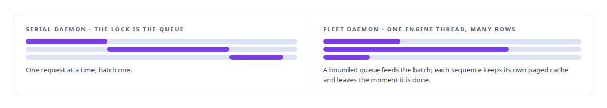
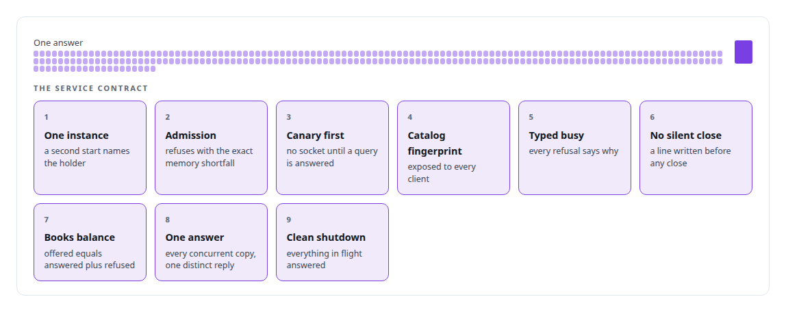
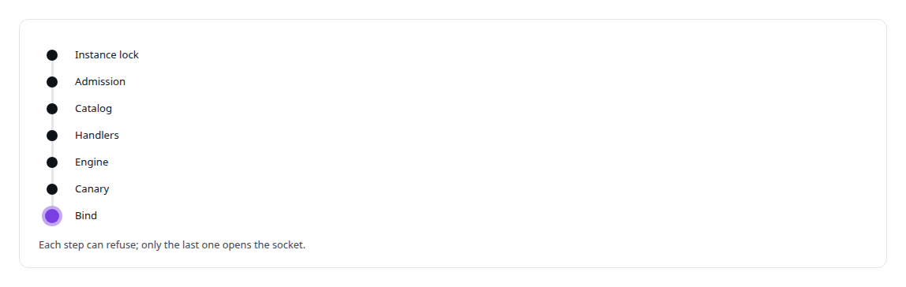

# Every request accounted for

**The tool-discovery model's fleet daemon has a nine-point service contract: 512 requests offered to 64 clients with a queue of sixteen gave 244 answered, 268 refused with a typed reason and none dropped, and a shutdown that answered every request in flight**

Canonical: https://coreyjames.ai/stories/every-request-accounted-for/  
Author: Corey James · Published: 2026-10-28 · Kind: story  
DOI: https://doi.org/10.5281/zenodo.23735124 (this page is a chapter of the system's report)  
Systems: [Capabilities model](https://github.com/coreyjames-ai/capabilities-model)  
Technologies: [CUDA C++](https://github.com/coreyjames-ai/portfolio/tree/main/technologies/cuda-c-plus-plus) · [Capacity engineering, backpressure and load testing](https://github.com/coreyjames-ai/portfolio/tree/main/technologies/capacity-engineering-backpressure-and-load-testing) · [Model Context Protocol (MCP)](https://github.com/coreyjames-ai/portfolio/tree/main/technologies/model-context-protocol-mcp) · [Rust](https://github.com/coreyjames-ai/portfolio/tree/main/technologies/rust) · [Unix domain sockets](https://github.com/coreyjames-ai/portfolio/tree/main/technologies/unix-domain-sockets)  
Skills: [inference serving architecture](https://github.com/coreyjames-ai/portfolio/tree/main/skills/inference-serving-architecture) · [MCP server design](https://github.com/coreyjames-ai/portfolio/tree/main/skills/mcp-server-design) · [distributed systems correctness](https://github.com/coreyjames-ai/portfolio/tree/main/skills/distributed-systems-correctness) · [high-throughput batch inference](https://github.com/coreyjames-ai/portfolio/tree/main/skills/high-throughput-batch-inference)  


## Result

| Figure | What it measures |
| --- | --- |
| **244** | answered, of 512 requests offered by 64 clients to a queue of sixteen |
| **268** | refused with a typed busy reason |
| **8 of 8** | requests in flight answered when the daemon was terminated |

## What was built

The tool-discovery model answers one question, which tool does this request need, for every agent in my estate, and it does so from a GPU it shares with a larger serving model. [A router beside a production model](https://coreyjames.ai/stories/a-router-beside-a-production-model) tells how it fits in the memory it is allowed. This is how it serves: a daemon whose contract says what happens to every request it is offered, including the ones it refuses.

## Two daemons

The serial daemon runs one thread per connection over a Unix socket and holds the engine behind a single mutex. Decode is batch-one there, so the mutex is the queue and nothing more is needed. The fleet daemon is the serving shape: connection threads feed a bounded queue, and one engine thread steps up to the batch limit of rows drawn from every sequence in flight, each with its own position in its own paged cache. A sequence leaves the batch the moment it finishes, so a short answer never waits for a long one.



The daemon is reachable as a standard tool-protocol server over standard input and over streamable HTTP with TLS, and its wire format is a length-prefixed frame.

## The contract

Nine conditions were written first, each with a measurement.



## Start-up in a fixed order




## What this demonstrates

Serving a small model with the discipline of a full service: a stated contract, typed refusals instead of silence, a measured load test against the contract, and a start-up order that makes a half-ready daemon impossible to reach.

The contract and the fleet design were mine; AI coding agents, a mix of frontier and open-source models, implemented the daemons and ran the gates under my governance system.

> A refusal before bind means no client ever saw a half-ready service.

## What was verified

Each line is a claim the canonical page supports, with the figure as the page states it.

- Service contracts for inference daemons: a nine-point contract under which 512 requests offered by 64 clients to a queue of sixteen gave 244 answered and 268 refused with a typed reason.
- Backpressure and load shedding: a bounded queue in which every refusal carries a typed busy reason and no request is dropped.
- Graceful shutdown: 8 of 8 requests in flight answered when the daemon was terminated.
- Continuous batching: one engine thread stepping rows from every sequence in flight, each in its own paged cache, so a short answer never waits for a long one.
- MCP server design: the daemon reachable as a standard tool-protocol server over standard input and over streamable HTTP with TLS.

## Related

- [A router beside a production model](https://github.com/coreyjames-ai/capabilities-model/tree/main/stories/a-router-beside-a-production-model) · https://coreyjames.ai/stories/a-router-beside-a-production-model/
- [Constraint made cheaper than no constraint](https://github.com/coreyjames-ai/capabilities-model/tree/main/stories/constraint-made-cheaper-than-no-constraint) · https://coreyjames.ai/stories/constraint-made-cheaper-than-no-constraint/
- [A hundred tokens instead of forty-two thousand](https://github.com/coreyjames-ai/capabilities-model/tree/main/stories/a-hundred-tokens-instead-of-forty-two-thousand) · https://coreyjames.ai/stories/a-hundred-tokens-instead-of-forty-two-thousand/

## Citation

Corey James. "Every request accounted for." coreyjames.ai, 2026. https://coreyjames.ai/stories/every-request-accounted-for/ In: the Capabilities model technical report, doi:10.5281/zenodo.23735124.

```bibtex
@misc{coreyjames-every-request-accounted-for,
  author = {Corey James},
  title = {Every request accounted for},
  year = {2026},
  howpublished = {\url{https://coreyjames.ai/stories/every-request-accounted-for/}},
  note = {GitHub copy: https://github.com/coreyjames-ai/capabilities-model/tree/main/stories/every-request-accounted-for},
  doi = {10.5281/zenodo.23735124}
}
```

Part of [Capabilities model](https://github.com/coreyjames-ai/capabilities-model) and [Corey James's portfolio](https://github.com/coreyjames-ai/portfolio) · site: https://coreyjames.ai/ · MCP server: https://coreyjames.ai/mcp · agent card: https://coreyjames.ai/.well-known/agent.json
