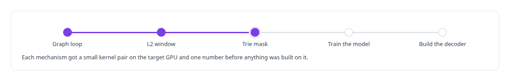
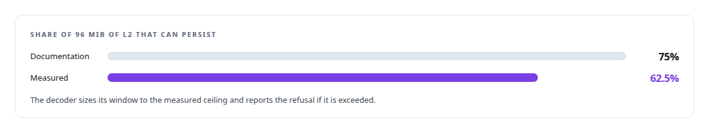
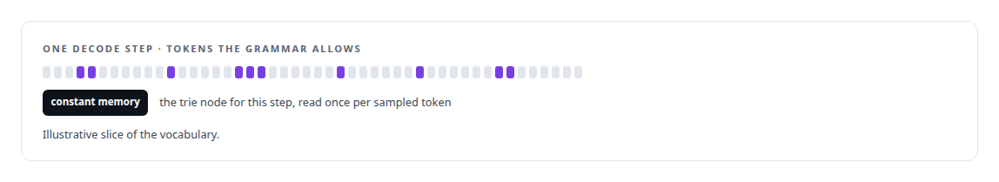

# Prove the mechanism before the model

**Three load-bearing ideas behind the custom decoder, a device-side graph loop, a persisting L2 window and a constant-memory trie mask, were each proved on the real GPU in a small lab before the model existed, and one of them contradicted the documentation**

Canonical: https://coreyjames.ai/stories/prove-the-mechanism-before-the-model/  
Author: Corey James · Published: 2026-10-28 · Kind: story  
DOI: https://doi.org/10.5281/zenodo.23735124 (this page is a chapter of the system's report)  
Systems: [Capabilities model](https://github.com/coreyjames-ai/capabilities-model)  
Technologies: [CUDA C++](https://github.com/coreyjames-ai/portfolio/tree/main/technologies/cuda-c-plus-plus) · [CUDA Driver API](https://github.com/coreyjames-ai/portfolio/tree/main/technologies/cuda-driver-api) · [GPU numerical kernel design](https://github.com/coreyjames-ai/portfolio/tree/main/technologies/gpu-numerical-kernel-design) · [Performance engineering and benchmarking](https://github.com/coreyjames-ai/portfolio/tree/main/technologies/performance-engineering-and-benchmarking)  
Skills: [GPU inference optimisation](https://github.com/coreyjames-ai/portfolio/tree/main/skills/gpu-inference-optimisation) · [CUDA kernel development](https://github.com/coreyjames-ai/portfolio/tree/main/skills/cuda-kernel-development) · [AI-assisted engineering methodology](https://github.com/coreyjames-ai/portfolio/tree/main/skills/ai-assisted-engineering-methodology) · [evidence-gated acceptance](https://github.com/coreyjames-ai/portfolio/tree/main/skills/evidence-gated-acceptance)  


## Result

| Figure | What it measures |
| --- | --- |
| **4.304 µs** | saved per token per kernel by looping on the device |
| **60 MiB** | of the 96 MiB L2, the set-aside ceiling measured on the card |
| **0.016 µs** | to consult the constant-memory mask at a 131,072-token vocabulary |

## What was built

The custom decoder for the tool-discovery model, told in [Constraint made cheaper than no constraint](https://coreyjames.ai/stories/constraint-made-cheaper-than-no-constraint), rests on three mechanisms that the whole design assumes will work: a decode loop that runs on the device under a graph whose continuation predicate the GPU itself writes, a window of L2 cache set aside so the model's weights stay resident between tokens, and a trie-shaped grammar mask served from constant memory. If any of the three had not worked on the generation of GPU I had, the decoder would have been built on sand. So before the model was trained, each was built and measured on its own, on the real card, with a toy body.



## The device graph loop

The first lab kernel pair runs a decode step inside a graph with a conditional node: the step writes a predicate, and the graph loops while the predicate holds, with no host round-trip per token.


That saving is what justified the graph-captured step in the decoder, and it is why the decoder's step writes its own continuation predicate.

## The L2 window

The second lab pits a kernel that reads the weights against an antagonist kernel that thrashes the cache, with a persisting-access window set aside in L2. The documentation suggests a ceiling for the set-aside, and the card disagreed; a request above the real ceiling is refused by the driver rather than clamped.



The measured gain for batch-one decode was about one percent, and the decoder's notes keep it as a fact, withdrawn as a lever.

## The constant-memory mask

The third lab serves the grammar's token mask from constant memory and measures the cost of consulting it during sampling. That cost is the number behind the decoder's claim that the grammar constraint costs nothing measurable, and it was in hand before the first constrained token was ever sampled.



## What this demonstrates

Separating the risky mechanisms from the system that depends on them, proving each on the target hardware with a measurement, and noting where the hardware disagreed with its own documentation.


The choice of mechanisms and the decision to prove them first were mine; AI coding agents, a mix of frontier and open-source models, built and ran the lab under my governance system.

> The decoder was then built on three numbers rather than three hopes.

## What was verified

Each line is a claim the canonical page supports, with the figure as the page states it.

- Hardware-first prototyping: three decoder mechanisms each proved on the real GPU in a small lab with a toy body before the model was trained.
- CUDA graphs and device-side control flow: a decode loop under a graph with a conditional node, 4.304 µs saved per token per kernel.
- GPU cache tuning: an L2 persisting window whose set-aside ceiling measured 60 MiB of the 96 MiB L2, against what the documentation suggests.
- Constant-memory kernel design: a grammar mask consulted in 0.016 µs at a 131,072-token vocabulary.

## Related

- [Constraint made cheaper than no constraint](https://github.com/coreyjames-ai/capabilities-model/tree/main/stories/constraint-made-cheaper-than-no-constraint) · https://coreyjames.ai/stories/constraint-made-cheaper-than-no-constraint/
- [A hundred tokens instead of forty-two thousand](https://github.com/coreyjames-ai/capabilities-model/tree/main/stories/a-hundred-tokens-instead-of-forty-two-thousand) · https://coreyjames.ai/stories/a-hundred-tokens-instead-of-forty-two-thousand/
- [Reading a file format by correlation](https://github.com/coreyjames-ai/capabilities-model/tree/main/stories/reading-a-file-format-by-correlation) · https://coreyjames.ai/stories/reading-a-file-format-by-correlation/

## Citation

Corey James. "Prove the mechanism before the model." coreyjames.ai, 2026. https://coreyjames.ai/stories/prove-the-mechanism-before-the-model/ In: the Capabilities model technical report, doi:10.5281/zenodo.23735124.

```bibtex
@misc{coreyjames-prove-the-mechanism-before-the-model,
  author = {Corey James},
  title = {Prove the mechanism before the model},
  year = {2026},
  howpublished = {\url{https://coreyjames.ai/stories/prove-the-mechanism-before-the-model/}},
  note = {GitHub copy: https://github.com/coreyjames-ai/capabilities-model/tree/main/stories/prove-the-mechanism-before-the-model},
  doi = {10.5281/zenodo.23735124}
}
```

Part of [Capabilities model](https://github.com/coreyjames-ai/capabilities-model) and [Corey James's portfolio](https://github.com/coreyjames-ai/portfolio) · site: https://coreyjames.ai/ · MCP server: https://coreyjames.ai/mcp · agent card: https://coreyjames.ai/.well-known/agent.json
