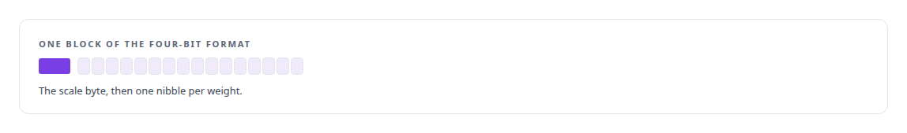
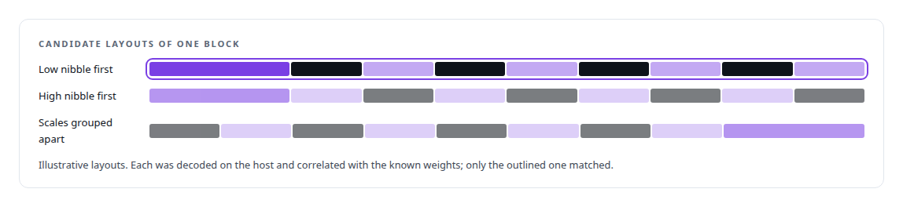
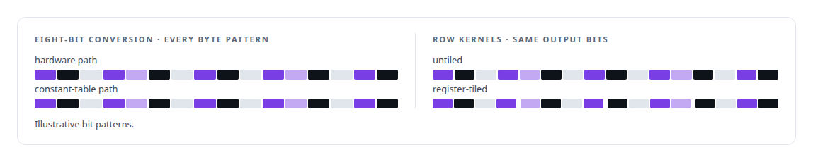
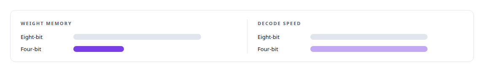

# Reading a file format by correlation

**The four-bit weight format's layout was established by correlating candidate decodings against the known weights before a kernel was written, 0.9955 against 0.0018, and four-bit was positioned as a footprint win rather than a speed win**

Canonical: https://coreyjames.ai/stories/reading-a-file-format-by-correlation/  
Author: Corey James · Published: 2026-10-28 · Kind: story  
Systems: [Capabilities model](https://github.com/coreyjames-ai/capabilities-model)  
Technologies: [CUDA C++](https://github.com/coreyjames-ai/portfolio/tree/main/technologies/cuda-c-plus-plus) · [Determinism and numerical reproducibility](https://github.com/coreyjames-ai/portfolio/tree/main/technologies/determinism-and-numerical-reproducibility) · [ML evaluation methodology](https://github.com/coreyjames-ai/portfolio/tree/main/technologies/ml-evaluation-methodology) · [Model quantization](https://github.com/coreyjames-ai/portfolio/tree/main/technologies/model-quantization)  
Skills: [LLM quantization (FP8, INT8, 4-bit)](https://github.com/coreyjames-ai/portfolio/tree/main/skills/llm-quantization-fp8-int8-4-bit) · [CUDA kernel development](https://github.com/coreyjames-ai/portfolio/tree/main/skills/cuda-kernel-development) · [AI-assisted engineering methodology](https://github.com/coreyjames-ai/portfolio/tree/main/skills/ai-assisted-engineering-methodology) · [GPU inference optimisation](https://github.com/coreyjames-ai/portfolio/tree/main/skills/gpu-inference-optimisation)  


## Result

| Figure | What it measures |
| --- | --- |
| **256** | byte patterns, every one, on which the hardware and table eight-bit paths agree |
| **2, 4, 8** | rows per block in the tiled kernels, each bit-identical to the untiled form |
| **2.53×** | denser in memory with four-bit weights, and no faster |

## What was built

The tool-discovery model ships in several precisions, and the smallest is a four-bit floating-point format with a block scale: a nibble per weight holding a two-bit exponent and a one-bit mantissa, and an eight-bit scale per block of weights. The format's documentation describes the arithmetic. It does not pin down, byte by byte, which nibble is which weight and how the block scales are laid out against them, and a kernel written against the wrong layout decodes plausible nonsense.



## Correlate before you write

I had the same weights in a known precision. So before any kernel was written, each candidate interpretation of the layout was decoded on the host and correlated against the known weights.



That gap left no room for doubt, and the layout went into the kernel as a fact with a number attached rather than as a reading of the documentation.

## The kernels

The four-bit kernels decode nibbles through lookup tables held in constant memory, one for the two-bit-exponent values and one for the eight-bit block scales, with a matrix-vector form for decode and a row form for prefill. Beside them sit the eight-bit kernels, where a hardware conversion path and a constant-table path exist together and a kernel proves they agree on every byte pattern, so the faster path can be used without a doubt about its correctness. The register-tiled row kernels, including paired projections in one launch, are bit-identical to the untiled form, which is the test that admits them.



## Footprint, not speed

On a card shared with a larger serving model, density is the margin that matters, and four-bit weights bought it. They did not make decode faster on this hardware.




## What this demonstrates

Treating an under-specified format as a measurement problem, admitting kernels by bit-identity with their simpler forms, and stating what a precision buys and what it does not.

The correlation method and the positioning of each precision were my decisions; AI coding agents, a mix of frontier and open-source models, wrote and tested the kernels under my governance system.

> The four-bit build is the footprint build, the eight-bit build is the serving build.

## What was verified

Each line is a claim the canonical page supports, with the figure as the page states it.

- Reverse engineering of binary formats: a four-bit weight layout established by correlating candidate decodings with known weights, 0.9955 against 0.0018, before a kernel was written.
- Low-precision kernel development: four-bit kernels decoding through constant-memory lookup tables, and eight-bit hardware and table paths shown to agree on all 256 byte patterns.
- LLM quantization trade-offs: four-bit weights positioned as a footprint win, 2.53 times denser in memory and no faster.
- Kernel equivalence testing: register-tiled row kernels at 2, 4 and 8 rows per block, each bit-identical to the untiled form.

## Related

- [Constraint made cheaper than no constraint](https://github.com/coreyjames-ai/capabilities-model/tree/main/stories/constraint-made-cheaper-than-no-constraint) · https://coreyjames.ai/stories/constraint-made-cheaper-than-no-constraint/
- [Prove the mechanism before the model](https://github.com/coreyjames-ai/capabilities-model/tree/main/stories/prove-the-mechanism-before-the-model) · https://coreyjames.ai/stories/prove-the-mechanism-before-the-model/
- [A router beside a production model](https://github.com/coreyjames-ai/capabilities-model/tree/main/stories/a-router-beside-a-production-model) · https://coreyjames.ai/stories/a-router-beside-a-production-model/

## Citation

Corey James. "Reading a file format by correlation." coreyjames.ai, 2026. https://coreyjames.ai/stories/reading-a-file-format-by-correlation/

```bibtex
@misc{coreyjames-reading-a-file-format-by-correlation,
  author = {Corey James},
  title = {Reading a file format by correlation},
  year = {2026},
  howpublished = {\url{https://coreyjames.ai/stories/reading-a-file-format-by-correlation/}},
  note = {GitHub copy: https://github.com/coreyjames-ai/capabilities-model/tree/main/stories/reading-a-file-format-by-correlation}
}
```

Part of [Capabilities model](https://github.com/coreyjames-ai/capabilities-model) and [Corey James's portfolio](https://github.com/coreyjames-ai/portfolio) · site: https://coreyjames.ai/ · MCP server: https://coreyjames.ai/mcp · agent card: https://coreyjames.ai/.well-known/agent.json
