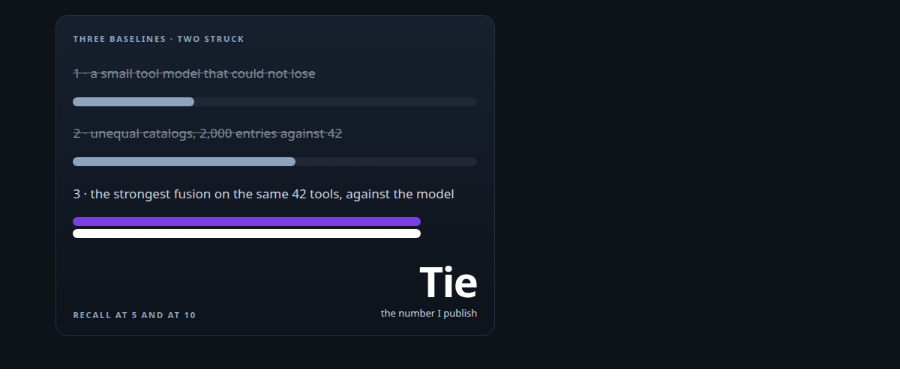
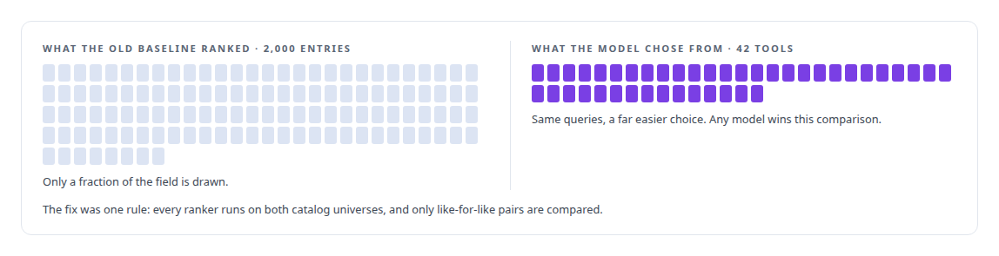
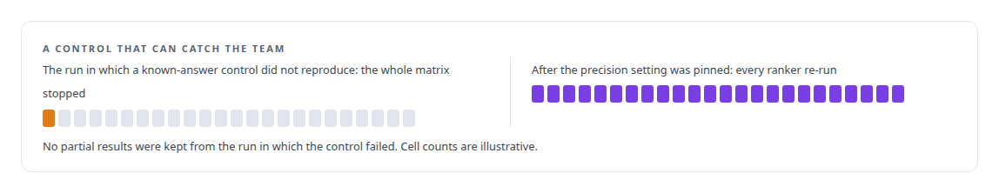
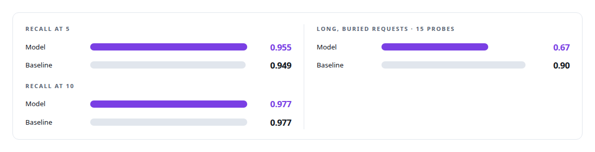

# The baseline that tied us

**Retiring a flattering benchmark, building the strongest retriever I could, and publishing the result that hurt**

Canonical: https://coreyjames.ai/stories/the-baseline-that-tied-us/  
Author: Corey James · Published: 2026-10-28 · Kind: story  
Systems: [Capabilities model](https://github.com/coreyjames-ai/capabilities-model)  
Technologies: [Catalog versioning and drift detection](https://github.com/coreyjames-ai/portfolio/tree/main/technologies/catalog-versioning-and-drift-detection) · [Governed AI-assisted software engineering](https://github.com/coreyjames-ai/portfolio/tree/main/technologies/governed-ai-assisted-software-engineering) · [Hugging Face Transformers](https://github.com/coreyjames-ai/portfolio/tree/main/technologies/hugging-face-transformers) · [Hybrid retrieval](https://github.com/coreyjames-ai/portfolio/tree/main/technologies/hybrid-retrieval) · [LLM fine-tuning](https://github.com/coreyjames-ai/portfolio/tree/main/technologies/llm-fine-tuning) · [ML evaluation methodology](https://github.com/coreyjames-ai/portfolio/tree/main/technologies/ml-evaluation-methodology) · [Model families and types](https://github.com/coreyjames-ai/portfolio/tree/main/technologies/model-families-and-types) · [ONNX Runtime](https://github.com/coreyjames-ai/portfolio/tree/main/technologies/onnx-runtime) · [Rust](https://github.com/coreyjames-ai/portfolio/tree/main/technologies/rust) · [Synthetic training-data generation](https://github.com/coreyjames-ai/portfolio/tree/main/technologies/synthetic-training-data-generation) · [Text embedding models](https://github.com/coreyjames-ai/portfolio/tree/main/technologies/text-embedding-models)  
Skills: [AI-assisted engineering methodology](https://github.com/coreyjames-ai/portfolio/tree/main/skills/ai-assisted-engineering-methodology)  



## Result

| Figure | What it measures |
| --- | --- |
| **17** | points of recall the first headline claimed, struck before publication |
| **469** | held-out queries, frozen before any model result was reported |
| **5** | embedding models in the bake-off for the baseline |

## What was built

My tool-discovery model had a headline: a large lead in recall over classical retrieval. The results were about to be written up and every incentive pointed at believing the number. I struck it. The comparison was against a weak baseline, and a weak baseline makes any model look good. I replaced it with the strongest classical retriever I could assemble. That retriever tied the model at the cutoffs that matter and beat it on long, buried requests. The tie is the number I publish.

## The challenge

The first comparison for the capabilities model was against an external small tool-calling model whose results carried no information: anything would have won. The second was against a retrieval baseline that, on inspection, had been ranking a catalog of two thousand entries while the model chose among forty-two.



## Constraints

The evaluation set was frozen before any model result was reported. The write-up was scheduled, and the headline was already in a draft. A baseline has to be fair in both directions: it must see the same catalog the model sees, and it must be tuned as carefully as the model was.

## My approach

The bar became the strongest classical retriever we could assemble, built with the same care as the model, and the instrument kept known-answer controls so it could catch the team as readily as it could catch the model. Every constant in the baseline was found by sweep. If the model could not beat that, the honest claim was a tie, and a tie on a hundred-token footprint is still a result.

## What I built

A frozen evaluation pair: the 469-query set plus fifteen long, buried requests where the needed tool is mentioned deep inside a verbose description.

A full-catalog fusion baseline combining dense embeddings with BM25, with every weight and cutoff chosen by sweep.

An embedding bake-off, which replaced an incumbent that had been chosen by habit.

Disqualifiers for latency and context length, so a baseline that was accurate and too slow or too large to deploy did not count.

A known-answer control inside the harness. When it failed to reproduce during one run, the whole experiment matrix was stopped and re-run after the cause, a numerical precision setting that changed rankings, was pinned.



An experiment matrix that ran every ranker on both catalog universes, so no comparison could again mix a 42-tool model against a 2,000-entry baseline.

## Difficult decisions

Choosing the stronger baseline knowing the outcome. I could see before the run that the fusion retriever would be close. I ran it anyway.


A never-quote list. The headline figure and the comparisons it came from went onto a written list of results that are never quoted, with the reason beside each.

## Results

Like for like, on the same 42 tools and the same 469 queries:



The model's surviving advantages, a standing cost of about a hundred tokens instead of forty-two thousand and a decoder that cannot produce a tool name outside the catalog, are what I quote.

## Technologies used

Rust evaluation harness · ONNX Runtime · BM25 · Dense embedding models · Pre-registered evaluation design · Known-answer controls

## What this demonstrates

Measurement integrity under pressure. I build the baseline that could beat me, I stop the run when the control fails, and I publish the result that hurts.

> A result I would not accept from someone else is a result I cannot publish.

## What was verified

Each line is a claim the canonical page supports, with the figure as the page states it.

- ML evaluation methodology: a 469-query held-out set frozen before any model result was reported, plus fifteen long, buried requests.
- Benchmark integrity: a 17-point recall headline struck before publication because its baseline had ranked two thousand entries against the model's forty-two.
- Hybrid retrieval baselines: a dense-plus-BM25 fusion retriever with every weight and cutoff chosen by sweep, which tied the model and beat it on buried requests.
- Embedding model selection: a bake-off of 5 embedding models that replaced an incumbent chosen by habit.
- Known-answer controls in experiment harnesses: a control that failed once stopped the whole matrix until a numerical precision setting was pinned and every ranker re-run.

## Related

- [A hundred tokens instead of forty-two thousand](https://github.com/coreyjames-ai/capabilities-model/tree/main/stories/a-hundred-tokens-instead-of-forty-two-thousand) · https://coreyjames.ai/stories/a-hundred-tokens-instead-of-forty-two-thousand/
- [A router beside a production model](https://github.com/coreyjames-ai/capabilities-model/tree/main/stories/a-router-beside-a-production-model) · https://coreyjames.ai/stories/a-router-beside-a-production-model/

## Citation

Corey James. "The baseline that tied us." coreyjames.ai, 2026. https://coreyjames.ai/stories/the-baseline-that-tied-us/

```bibtex
@misc{coreyjames-the-baseline-that-tied-us,
  author = {Corey James},
  title = {The baseline that tied us},
  year = {2026},
  howpublished = {\url{https://coreyjames.ai/stories/the-baseline-that-tied-us/}},
  note = {GitHub copy: https://github.com/coreyjames-ai/capabilities-model/tree/main/stories/the-baseline-that-tied-us}
}
```

Part of [Capabilities model](https://github.com/coreyjames-ai/capabilities-model) and [Corey James's portfolio](https://github.com/coreyjames-ai/portfolio) · site: https://coreyjames.ai/ · MCP server: https://coreyjames.ai/mcp · agent card: https://coreyjames.ai/.well-known/agent.json
