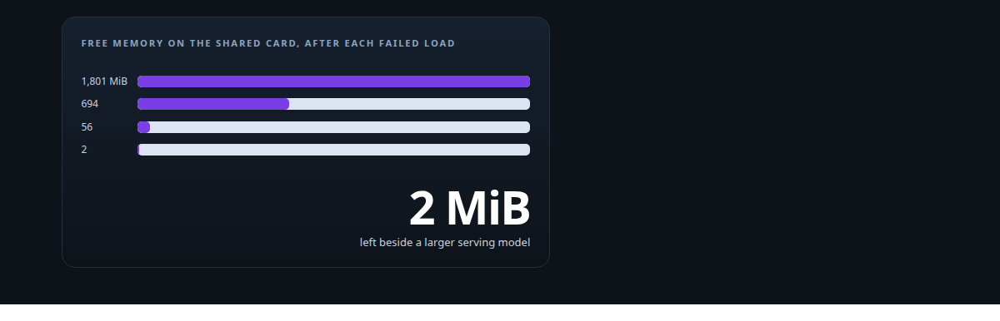
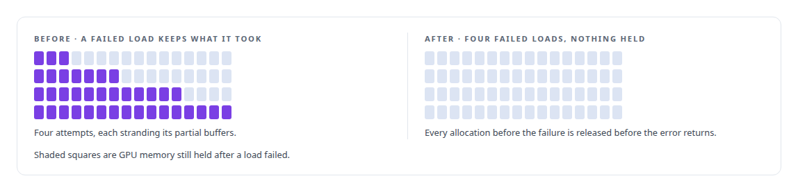
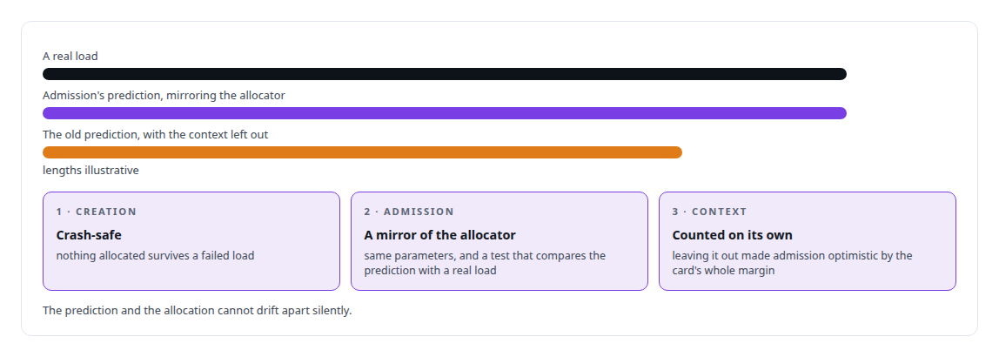

# The recovery that drained the card

**Four failed engine loads took a shared GPU from 1,801 MiB free to 2, because partial allocations were never released; the fix made creation crash-safe and made the admission arithmetic match the allocation it predicts**

Canonical: https://coreyjames.ai/stories/the-recovery-that-drained-the-card/  
Author: Corey James · Published: 2026-10-28 · Kind: story  
DOI: https://doi.org/10.5281/zenodo.23735124 (this page is a chapter of the system's report)  
Systems: [Capabilities model](https://github.com/coreyjames-ai/capabilities-model)  
Technologies: [CUDA C++](https://github.com/coreyjames-ai/portfolio/tree/main/technologies/cuda-c-plus-plus) · [CUDA Driver API](https://github.com/coreyjames-ai/portfolio/tree/main/technologies/cuda-driver-api) · [GPU admission control and co-residency](https://github.com/coreyjames-ai/portfolio/tree/main/technologies/gpu-admission-control-and-co-residency) · [GPU memory management](https://github.com/coreyjames-ai/portfolio/tree/main/technologies/gpu-memory-management) · [Rust](https://github.com/coreyjames-ai/portfolio/tree/main/technologies/rust)  
Skills: [TensorRT and TensorRT-LLM engineering](https://github.com/coreyjames-ai/portfolio/tree/main/skills/tensorrt-and-tensorrt-llm-engineering) · [distributed systems correctness](https://github.com/coreyjames-ai/portfolio/tree/main/skills/distributed-systems-correctness) · [vLLM internals](https://github.com/coreyjames-ai/portfolio/tree/main/skills/vllm-internals) · [inference serving architecture](https://github.com/coreyjames-ai/portfolio/tree/main/skills/inference-serving-architecture)  



## Result

| Figure | What it measures |
| --- | --- |
| **4** | failed engine loads in a row, each one passing admission |
| **~503 MiB** | the CUDA context the admission arithmetic had left out |
| **2,740** | MiB, the engine's whole allowance beside a 30B serving model |

## What was built

The tool-discovery engine lives on a GPU beside a 30-billion-parameter serving model, in a fixed allowance and no more. An admission check compares the engine's requirement with the card's free memory before anything is allocated, and refuses with the shortfall if it does not fit. That check once passed every time while the engine failed to load every time, and the card drained.

## What went wrong

Engine creation allocated its buffers in sequence, and when a later allocation failed, the earlier ones were not freed before the error returned. Each retry therefore started with less free memory than the last, passed admission because the arithmetic looked only at the engine's own total, and failed further along. A larger serving model was sharing that card.



## Three fixes




## Admission in the batched engine

The batched engine extends the same discipline to each request: admission reserves cache pages for the prompt and the maximum output before a sequence is admitted, and refuses with a typed reason when the pages are not there. The daemon's contract in [Every request accounted for](https://coreyjames.ai/stories/every-request-accounted-for) rests on that refusal being exact.


## What this demonstrates

Memory discipline on shared hardware: a failure path that restores the state it found, an admission check that is proven to match the allocation it predicts, and the overhead the driver adds counted rather than assumed away.

The crash-safe rule and the mirrored arithmetic were my requirements; AI coding agents, a mix of frontier and open-source models, implemented and tested them under my governance system.

> A failed load leaves the card as it found it.

## What was verified

Each line is a claim the canonical page supports, with the figure as the page states it.

- GPU memory management: engine creation made crash-safe after four failed loads took a shared GPU from 1,801 MiB free to 2.
- Admission control for GPU memory: admission arithmetic made to mirror the allocator, including the ~503 MiB CUDA context it had left out.
- Incident root-cause analysis: four failed loads, each passing admission, traced to partial allocations never released and a context missing from the arithmetic.
- Inference serving on shared GPUs: an engine held to a 2,740 MiB allowance beside a 30B serving model, with cache pages reserved per request before admission.

## Related

- [A router beside a production model](https://github.com/coreyjames-ai/capabilities-model/tree/main/stories/a-router-beside-a-production-model) · https://coreyjames.ai/stories/a-router-beside-a-production-model/
- [Every request accounted for](https://github.com/coreyjames-ai/capabilities-model/tree/main/stories/every-request-accounted-for) · https://coreyjames.ai/stories/every-request-accounted-for/
- [Constraint made cheaper than no constraint](https://github.com/coreyjames-ai/capabilities-model/tree/main/stories/constraint-made-cheaper-than-no-constraint) · https://coreyjames.ai/stories/constraint-made-cheaper-than-no-constraint/

## Citation

Corey James. "The recovery that drained the card." coreyjames.ai, 2026. https://coreyjames.ai/stories/the-recovery-that-drained-the-card/ In: the Capabilities model technical report, doi:10.5281/zenodo.23735124.

```bibtex
@misc{coreyjames-the-recovery-that-drained-the-card,
  author = {Corey James},
  title = {The recovery that drained the card},
  year = {2026},
  howpublished = {\url{https://coreyjames.ai/stories/the-recovery-that-drained-the-card/}},
  note = {GitHub copy: https://github.com/coreyjames-ai/capabilities-model/tree/main/stories/the-recovery-that-drained-the-card},
  doi = {10.5281/zenodo.23735124}
}
```

Part of [Capabilities model](https://github.com/coreyjames-ai/capabilities-model) and [Corey James's portfolio](https://github.com/coreyjames-ai/portfolio) · site: https://coreyjames.ai/ · MCP server: https://coreyjames.ai/mcp · agent card: https://coreyjames.ai/.well-known/agent.json
