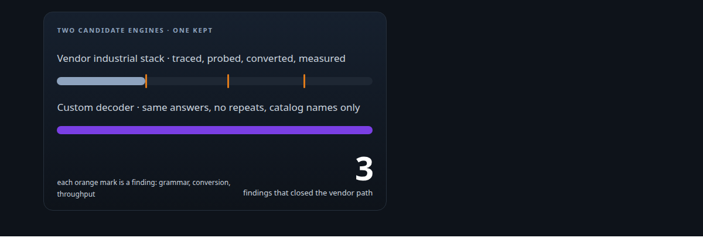
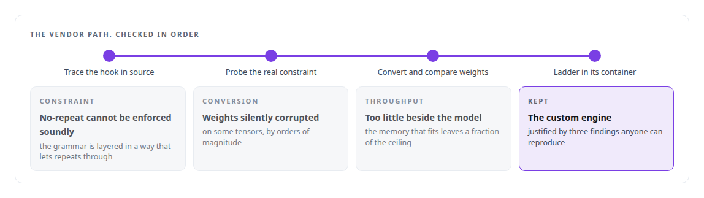
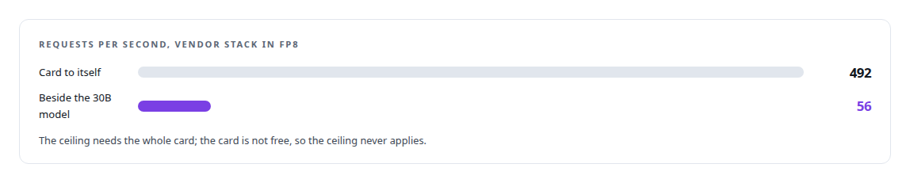

# Trying the industrial path first

**Evaluating the standard vendor serving stack for a custom decoder, and closing that path on measurements**

Canonical: https://coreyjames.ai/stories/trying-the-industrial-path-first/  
Author: Corey James · Published: 2026-10-28 · Kind: story  
DOI: https://doi.org/10.5281/zenodo.23735124 (this page is a chapter of the system's report)  
Systems: [Capabilities model](https://github.com/coreyjames-ai/capabilities-model)  
Technologies: [CUDA C++](https://github.com/coreyjames-ai/portfolio/tree/main/technologies/cuda-c-plus-plus) · [GPU inference engine engineering](https://github.com/coreyjames-ai/portfolio/tree/main/technologies/gpu-inference-engine-engineering) · [Grammar-constrained decoding](https://github.com/coreyjames-ai/portfolio/tree/main/technologies/grammar-constrained-decoding) · [ML evaluation methodology](https://github.com/coreyjames-ai/portfolio/tree/main/technologies/ml-evaluation-methodology) · [Model families and types](https://github.com/coreyjames-ai/portfolio/tree/main/technologies/model-families-and-types) · [NVIDIA Blackwell GPUs](https://github.com/coreyjames-ai/portfolio/tree/main/technologies/nvidia-blackwell-gpus) · [NVIDIA TensorRT-LLM](https://github.com/coreyjames-ai/portfolio/tree/main/technologies/nvidia-tensorrt-llm) · [Vendor-integration reverse engineering](https://github.com/coreyjames-ai/portfolio/tree/main/technologies/vendor-integration-reverse-engineering)  
Skills: [TensorRT and TensorRT-LLM engineering](https://github.com/coreyjames-ai/portfolio/tree/main/skills/tensorrt-and-tensorrt-llm-engineering) · [inference serving architecture](https://github.com/coreyjames-ai/portfolio/tree/main/skills/inference-serving-architecture) · [AI-assisted engineering methodology](https://github.com/coreyjames-ai/portfolio/tree/main/skills/ai-assisted-engineering-methodology) · [GPU inference optimisation](https://github.com/coreyjames-ai/portfolio/tree/main/skills/gpu-inference-optimisation)  



## Result

| Figure | What it measures |
| --- | --- |
| **4** | checks on the vendor path, any one of which could have kept it |
| **3** | guarantees any engine had to keep: identical answers, no repeats, catalog names only |
| **1,000×** | weight corruption on some tensors after the vendor conversion |

## What was built

When the tool-discovery model needed to serve two thousand concurrent clients, the obvious answer was the vendor's industrial serving stack. I directed that it be tried first, before any custom engine was justified. It was traced to its extension point in source, probed against my decoding constraints, and measured in the vendor's own container. It did not fit, for three reasons I could show, and the custom engine was kept.

## The challenge

Building a custom GPU decoder is expensive and easy to justify badly.


 

## Constraints

Identical answers, so switching engines could not change what an agent was told. The decoding constraints are what make the model safe to use. And a shared GPU: the stack had to fit beside the 30B model.

## My approach

Trace, probe, measure. Find where the vendor stack allows a decoding constraint to be inserted, read that code, probe it with the real constraint, convert the model with the vendor's tooling and check the weights, then run a throughput ladder in the vendor's container with and without the 30B model resident.



## What I built

Probes against the stack's guided-decoding extension point using the real catalog constraint.

A conversion verdict comparing converted weights against the source.

A throughput ceiling study run inside the vendor container, with the card to itself and with the 30B model resident.

## Difficult decisions

Closing a path I had chosen. I had directed the vendor-first approach and expected it to work. Three findings closed it, and the throughput one is drawn below.

## Results

Measured in the vendor's own container, on the shared GPU:



## Technologies used

TensorRT-LLM · Grammar-constrained decoding libraries · CUDA · NVIDIA Blackwell GPUs

## What this demonstrates

Vendor-neutral judgment. I try the standard tool first, and when it does not fit I can show exactly why with measurements, which is the only justification a custom engine deserves.

> If a standard stack would serve the model at the required concurrency with the required guarantees, the custom engine was the wrong choice however satisfying it was to build.

## What was verified

Each line is a claim the canonical page supports, with the figure as the page states it.

- Vendor stack evaluation: the vendor's industrial serving stack traced to its extension point in source, probed with the real constraint and measured in its own container before a custom engine was kept.
- TensorRT and TensorRT-LLM engineering: a conversion verdict that found weight corruption of 1,000 times on some tensors after the vendor conversion.
- Grammar-constrained decoding: probes of the stack's guided-decoding extension point showing the no-repeat constraint could not be enforced soundly.
- GPU performance benchmarking: a throughput ceiling study in the vendor's container, 492 requests a second with the card to itself against 56 beside the 30B model.

## Related

- [A hundred tokens instead of forty-two thousand](https://github.com/coreyjames-ai/capabilities-model/tree/main/stories/a-hundred-tokens-instead-of-forty-two-thousand) · https://coreyjames.ai/stories/a-hundred-tokens-instead-of-forty-two-thousand/
- [A router beside a production model](https://github.com/coreyjames-ai/capabilities-model/tree/main/stories/a-router-beside-a-production-model) · https://coreyjames.ai/stories/a-router-beside-a-production-model/
- [Bit-identical across batch compositions](https://github.com/coreyjames-ai/capabilities-model/tree/main/stories/bit-identical-across-batch-compositions) · https://coreyjames.ai/stories/bit-identical-across-batch-compositions/

## Citation

Corey James. "Trying the industrial path first." coreyjames.ai, 2026. https://coreyjames.ai/stories/trying-the-industrial-path-first/ In: the Capabilities model technical report, doi:10.5281/zenodo.23735124.

```bibtex
@misc{coreyjames-trying-the-industrial-path-first,
  author = {Corey James},
  title = {Trying the industrial path first},
  year = {2026},
  howpublished = {\url{https://coreyjames.ai/stories/trying-the-industrial-path-first/}},
  note = {GitHub copy: https://github.com/coreyjames-ai/capabilities-model/tree/main/stories/trying-the-industrial-path-first},
  doi = {10.5281/zenodo.23735124}
}
```

Part of [Capabilities model](https://github.com/coreyjames-ai/capabilities-model) and [Corey James's portfolio](https://github.com/coreyjames-ai/portfolio) · site: https://coreyjames.ai/ · MCP server: https://coreyjames.ai/mcp · agent card: https://coreyjames.ai/.well-known/agent.json
